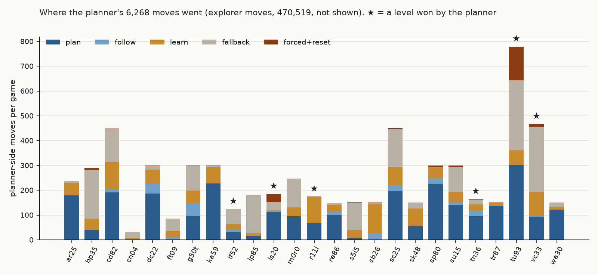
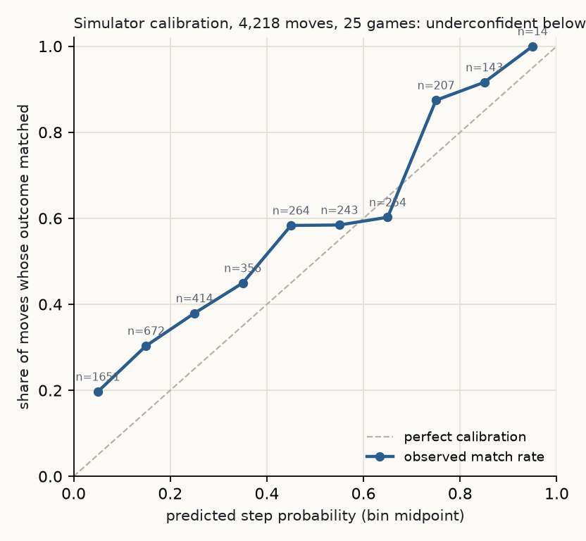

# Plan, simulate, check: learning an ARC-AGI-3 game's rules while playing it

Subtitle: An offline 27B model proposes move segments, a simulator built from learned rules checks them first, and every prediction is logged.

Submitted to the Kaggle competition arc-prize-2026-paper-track on 2026-11-09 as the Writeup body (Project Description, markdown). Card image: `figures/kaggle-writeup/card-560x280.png`. Project links: this repository and the notebook `hgenix20/arc3-mind-agent` (version 13 = submission 57844971). Every number traces to `docs/experiment-log.md`, `docs/superpowers/plans/2026-10-31-v2-gaps.md`, `bench/evals/2026-10-31-planner-v1/` or, for the second architecture, github.com/hgenix20/arc3-curiosity-agent `docs/observations/2026-10-31-kaggle-run.md`.

## Abstract

This paper documents Kaggle submission 57844971 to ARC-AGI-3 (public score 0.33) and measures the distance between learning a game's rules and fluid intelligence. The agent plays each unseen game by storing rules as facts with Beta probabilities, planning against a simulator built from those facts, and asking an offline Qwen3.6-27B model for short move segments that the simulator checks before any real move. One run of the 25 public games finished 33 levels (offline scorecard 0.59). Prediction accuracy on the agent's own moves reached 0.88, yet the planner made 1.3% of all moves and won six levels, while a model-free graph explorer won the other 27. Control logic set the score, and the records name the capacities the agent lacked.

## Introduction

ARC-AGI-3 presents a 64 by 64 grid of colour indices, a list of action ids with no stated meaning, and a score that rewards finishing each level in as few moves as a human needed. Nothing tells the agent what an action does, what counts as progress, or what ends the game. The benchmark therefore measures how efficiently an agent builds and revises a working model of a novel environment from its own experience, which is the sense of fluid intelligence used here.

We built an agent whose learning could be inspected, to a written specification, and then measured it against that specification on the public games with no per-game tuning and no hard-coded moves. The measurement separates engineering defects from absent capacities, and that separation is the paper's contribution.

## Prior work

Planning with a learned model of the environment has a long lineage: Sutton's Dyna integrated learning, planning and reacting over a learned model, MuZero plans with a learned latent model across board games and Atari, and Dreamer learns behaviours inside a learned latent world model. Our model is symbolic, rules keyed by action, object kind and context, each carrying hit and miss counts whose Beta-Bernoulli posterior mean is its probability. The 2025 paper-track winner, Jolicoeur-Martineau's tiny recursive networks, sits at the opposite end of the scale axis. We use a large pretrained language model only as a proposer whose output is verified before execution.

## Approach

Perception turns each frame into a scene of things: connected same-colour components with a kind id from shape and colour.

A fact states that action A on a thing of kind K in context C produces effect E. Each fact carries hits and misses and the probability (hits + 1) / (hits + misses + 2), the mean of a Beta(1,1) posterior, in three bands: certain at 0.8 and above, low below 0.3, medium between, and a hypothesis becomes a fact after five consecutive hits.

Prediction is read-only: given a scene and a move, the facts yield the next scene and a step probability, and a segment's path probability is the product of its steps, with 0.5 for any step no fact covers. Candidate paths to each open goal are ranked by EV = p_path × 100 × efficiency − p_harm × restart cost, where efficiency is the agent's own estimate of moves per level and the restart cost is the moves lost if the path kills it.

The planner is Qwen3.6-27B-FP8, served by vLLM on the competition GPU with no internet. Its briefing holds the scene, the rules with their probabilities, the open goals, the plan tree, recent harm, and lessons from earlier games. It answers in a fixed contract: a model of the game, new facts, goals, and either a segment of at most 12 moves or a skill call. Every segment is rolled out before its first move is sent, each real move is compared with its prediction, and the first miss breaks the segment.

Deaths and health-bar drops are recorded against (label, kind) keys with the same Beta counts; a move in the harm band is refused unless no other route to the goal exists and the rule has been tried fewer than three times on the level.

The controller's gates run in a fixed order: harm, segment broke, 25 fallback moves in a row, 40 moves without progress, budget. After 150 planner moves on a level, or 25 consecutive fallbacks, the level passes to a state-graph explorer that plays without the model. Rules confirmed at a level win enter a long-term store keyed without colour and return as lessons to later games. Every move is logged with its prediction, its outcome and the gate state, and every metric below comes from these records.

## Results

Submission 57844971 scored 0.33 publicly, whereas two simpler predecessors, the model driving the fluid agent directly (57746426) and the fluid agent with no model (57637984), each scored 0.39.

One run of the 25 public games on the competition GPU finished 33 levels for an offline scorecard of 0.59, with six games finishing no level.

Of 476,787 actions the planner made 6,268 (1.3%) and the explorer made the rest (Figure 1). The planner won 6 of the 33 levels, two of them under the human move count with zero deaths (lf52 level 1 in 10 moves against 32; tn36 level 1 in 14 against 32). Only one of the six winning moves came from a planner segment. The 1,077 planner calls took 11.0 s each and consumed 42% of all game seconds.

Prediction accuracy on the planner's own moves was 0.88 (per game 0.46 to 1.00; 20 of 25 games above 0.75). The step probability was monotone yet underconfident by 0.10 to 0.20 in every bin below 0.7 (Figure 2), and the median path probability was 0.04, so the expected-value ranking compared noise.

## What we learned

The learning parts behaved as specified: the simulator predicted correctly where facts existed, and every failure below was diagnosed from the records without a replay; three control mechanisms then decided the score.

Harm never reached the veto band: in tu93 the agent died 68 times to one kind while that kind's harm probability sat between 0.05 and 0.14, because trials were counted on every move near the kind, which diluted the estimate.

A stale counter locked the planner out, because after the explorer won a level the fallback counter was not reset, so ten later level instances received 25 fallback moves and no planner call before being handed back. In lp85 the explorer won five levels while the planner spent 125 moves in them, every one a fallback.

The first call set the whole level, since nine games lost call zero to a timeout on the shared model server at cold start, with no retry, and two games never completed a call.

In each case a rule was right and its trigger was wrong. The rule store, the simulator and the gates worked in isolation; the scheduling logic connecting them is what the leaderboard measured, which is why the per-move record is published beside the score.

## Gaps against fluid intelligence

The records show five absences that no bug fix supplies.

The agent never induced from the frames what finishing a level means; fourteen goals stood confirmed at game end against 2,820 still open. A second architecture we built on a different premise (a player model and an observer model that checks the player's claims against the frames, with no rule store) finished 12 levels on the same games, won level 1 of ar25 in every run and level 2 in none, and changed its goal 520 times in 531 turns, so neither agent carried any representation of a completion condition.

Transfer did not occur: the one later level the planner won took 29 moves against a mean of 24.6 on its five first-level wins, the long-term store held 50 rules, 39 of them no-ops, and no planner reply out of 1,078 referenced a lesson.

Identity was never abstracted: kinds are shape-and-colour hashes, so a rule learned about a mover in one game cannot match a functionally identical object in another.

Budgets went unrecognised, in that status bars which shrink with each move appeared in at least six public games, and neither agent treated one as a resource to conserve.

Repetition did not trigger revision: disconfirmed rules were almost never repeated (rate 0.0065), yet the same death recurred 68 times, because harm evidence and rule evidence lived in separate books.

## Conclusion

The entry is a rule store with probabilities, a simulator that reads it, a proposer and a checker, and a complete per-move record. It finished 33 public levels, scored 0.33 on the hidden set, and showed that its control logic bounded the score while its learning held. What remains are capacities: inducing a completion condition, transferring across levels, abstracting identity by role, and treating indicators as budgets. The twelve measured gaps with their evidence, the specification, the logs and the code are public in the linked repository under the MIT license.

Code: https://github.com/hgenix20/arc3-mind-agent (branch agent-v2). Notebook: https://www.kaggle.com/code/hgenix20/arc3-mind-agent. Second architecture: https://github.com/hgenix20/arc3-curiosity-agent.
