# Agent Specification v2: Process, Modules, and Build Path

Status: draft for review, 2026-10-31. Owner: Kameron. Prepared by Claude.
Supersedes the refactor parts (1 to 9) and the as-built section as the working spec. Those
documents stay as the record of the comparison. Every decision Kameron made in the review
comments of 2026-10-30 and 2026-10-31 is in section 6. Nothing here is built.

## 0. How to read this document

**Status labels on every module.**

- **Built.** The code exists and is on the current path. The file is named.
- **Built, changes.** The code exists. This spec changes its contract or its use.
- **Built, off path.** The code exists and is not on the current path. Section 5 says whether it is kept.
- **New.** No code exists. The spec describes it fully enough to build.
- **Dropped.** Kameron decided it is not part of the new agent (section 6).

**Workflow graphs.** Each process has a graph. Graphs come at three depths:

- **Depth 0.** The whole game, from start to end. Section 2.
- **Depth 1.** One stage of the depth 0 graph, for example the per-move loop. Section 3.1 to 3.4.
- **Depth 2.** A sub-process inside a stage, for example how a hypothesis is simulated. Section 3.5 onward.

In the graphs, rectangles are steps, diamonds are decisions, and rounded boxes are stores
(memory and logs). Arrows are the order of control. Labels on arrows give the condition.

**Logic, not code.** Each module is written as numbered rules of the form IF condition
THEN result, plus its inputs, outputs, stores, and tests. The rules are the contract.
Implementation picks the data structures. Where a number is a placeholder, it is marked
PLACEHOLDER and listed in section 7.

**Terms.**

- **Scene.** The objects on screen at one moment, with their colours, positions, and kinds.
- **Move.** One action sent to the game. A click is a move.
- **Level instance.** One attempt at a level. A death or a reset starts a new level instance
  of the same level. Working memory belongs to the game, not to the level instance.
- **Rule.** A stated regularity about objects, actions, events, or experiences. It has a
  status: hypothesis or fact (section 4.2).
- **Hypothesis (goal hypothesis).** One way to complete a level task, with a probability.
  Different from a rule hypothesis, which is a candidate regularity. The text says which.
- **Sequence.** An ordered list of moves that serves one task.
- **Fork.** A point where the agent can reach the same goal by two or more paths
  (Kameron, 2026-10-31: "a plan or path that could go two ways toward the same goal").

## 1. Scope, goals, and constraints

**Goal.** An agent that completes levels in games it has not seen, by learning how the game
works from play, and that can show this learning is real. Kameron's words: the agent "must
have true learning and fluid intelligence capabilities."

**Scoring.** Per level, the score is `min(human_actions / agent_actions, 1)^2`
(`docs/agent-submission.md`). The game score weights levels by level index, and the total is the
mean over games. The agent never reads the human action counts at runtime. The counts exist
in the local game metadata (`baseline_actions`) and the scorer uses them. So every "moves
per level" target in this spec is an estimate the agent builds from its own completions
(section 4.8, horizon rule).

**Runtime and environment.** 110 private games. 9 hours of runtime. No internet during the
run. Offline model weights must be open (competition rules, section 6 of the rules as pasted
2026-10-29). Each level gives a move counter in some games and none in others.

**Constraints that govern every module.**

- **C1. No tuning on the public games.** The 25 public games are observation only. Their logs
  show gaps in learning, intelligence, and code. They are never used to pick a threshold,
  a move, or a rule for a named game (Kameron, 2026-10-30: "games should not be used for
  tuning ... We can use the played games as observations to understand gaps").
- **C2. No hard-coded moves and no per-game answers.** No module names a game, a level, or a
  sprite. Rules come from observation.
- **C3. Concepts are learned, not coded.** Mechanics are learned as rules. The agent should
  combine learned concepts (for example, jump plus run gives a running jump). Where a
  general strategy is written down, it is a skill with a trigger on object and event kinds
  (section 4.9), not a rule for one game.
- **C4. The model decides, the simulator checks.** The language model proposes plans. The
  simulator predicts each plan before a real move. The executor checks each real move against
  the prediction (Kameron, 2026-10-31: the LLM "uses a simulated model of the game to check
  the next few moves and then ... write the next few sequence of moves before it has to
  remodel and simulate again").
- **C5. Every step is logged.** A move without a log record is a defect.

**Final submission date.** Kameron's comment (2026-10-30): "11-1 is the last and final
submission allowed." An earlier note in this project said 2026-11-02 23:59 UTC. This spec
uses 2026-11-01. Open item O1 asks for confirmation against the competition page.

## 2. The whole game, end to end (depth 0)

Each game is one run. A run plays one game from start to end. The end of a game is a win,
or the game ending with no moves left, or the run deadline.

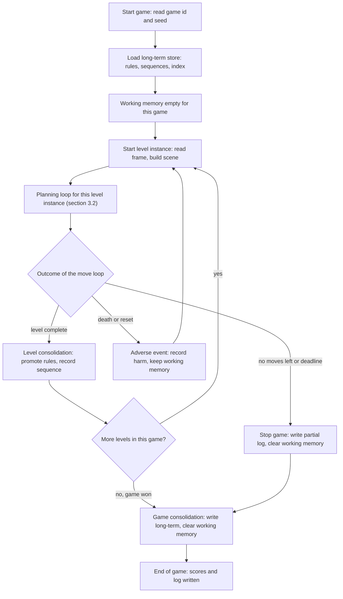

Reading the graph. The loop from "Start level instance" back to itself is the level cycle.
A death does not clear working memory (Kameron, 2026-10-30: "working memory should not clear
on a game lost since that memory will be needed to replay"). Consolidation writes to
long-term memory during the run, which Kameron allowed (2026-10-30).

## 3. Process graphs (depth 1 and 2)

### 3.1 Depth 1: the per-move loop

This runs once for every move. It is the heart of the agent.

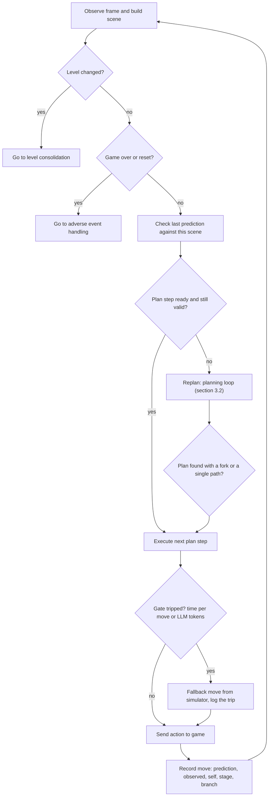

Notes. "Check last prediction" is the miss test: a miss that matters stops the plan
(section 4.10). "Replan" is the planning loop. A gate trip never stops the run. It sends a
fallback move and logs it (section 4.10).

### 3.2 Depth 1: the planning loop

This is Kameron's planning process, used by the agent for its own planning (Kameron,
2026-10-31: "its for the agent's own planning"). It runs on every replan and at each level start.

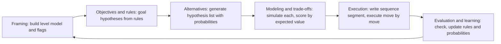

Reading the graph. Evaluation returns to Framing, but a miss that matters returns to
Alternatives first, from the last fork (section 3.6). Framing is repeated only when the
level changes or when the level model needs rebuilding.

### 3.3 Depth 2: how alternatives are generated

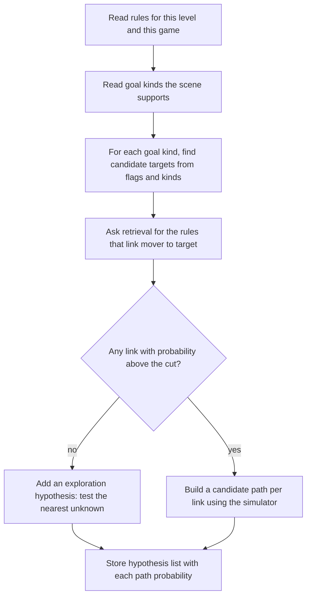

### 3.4 Depth 2: the expected-value choice

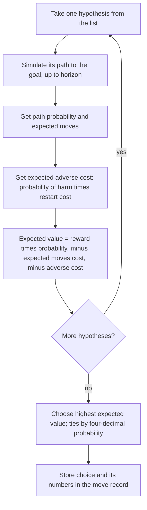

### 3.5 Depth 2: the sequence write and execute cycle

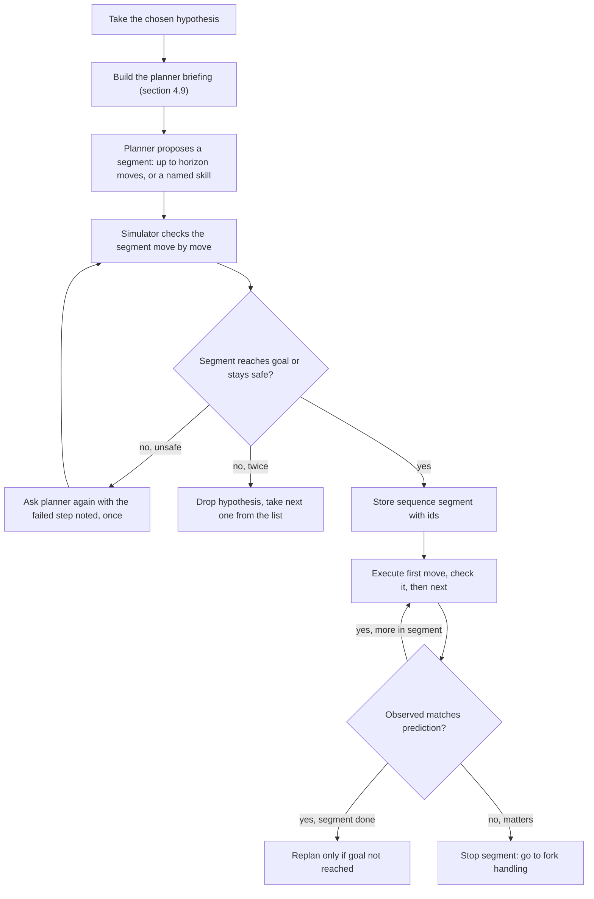

### 3.6 Depth 2: fork handling and replan

Kameron, 2026-10-31: "it should keep the moves that got there" and the agent "would take the
shortest path or least dangerous path, whichever is more favorable for the score."

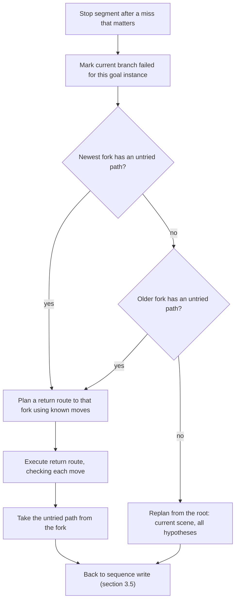

### 3.7 Depth 2: learning from one transition

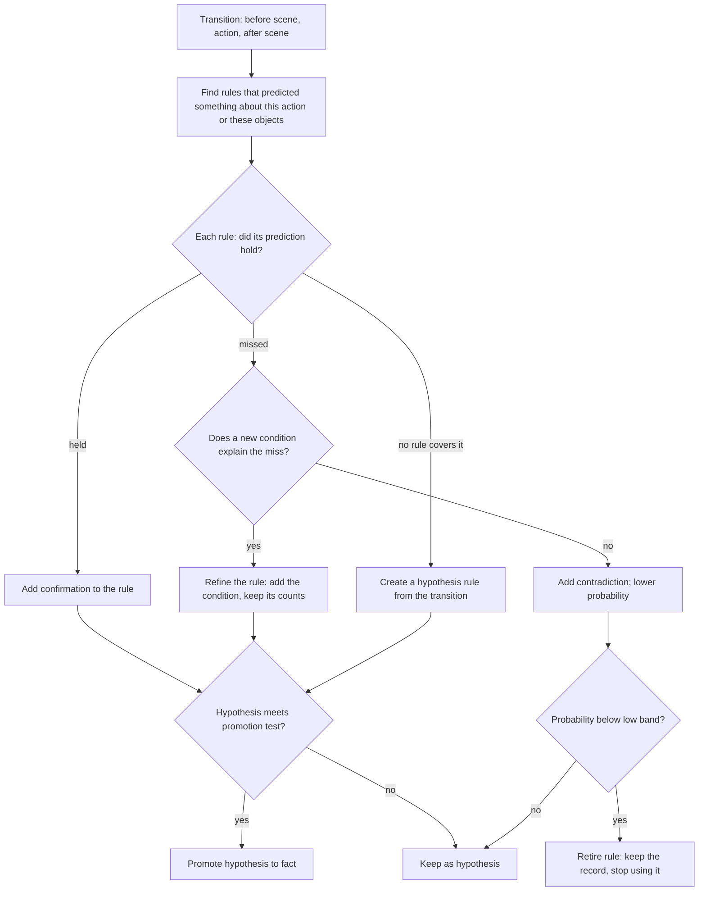

### 3.8 Depth 2: retrieval

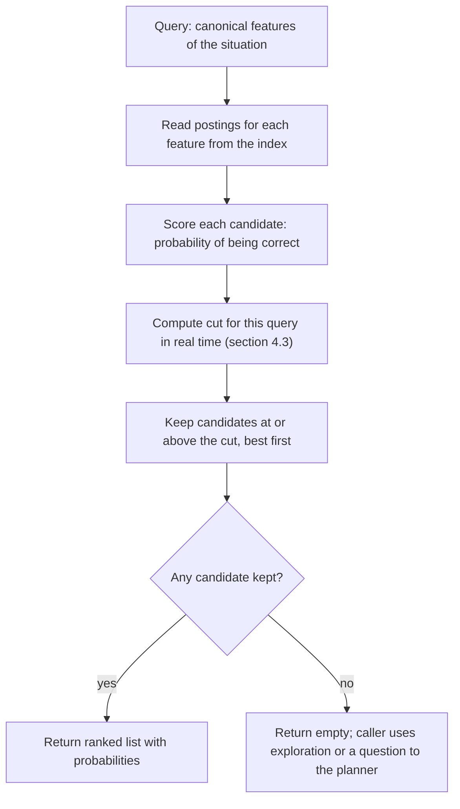

### 3.9 Depth 2: harm, inhibition, and perseverance

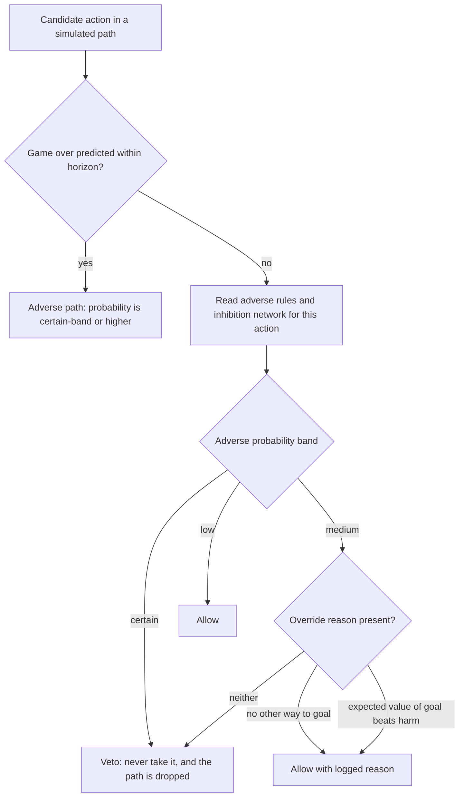

### 3.10 Depth 2: curiosity checks

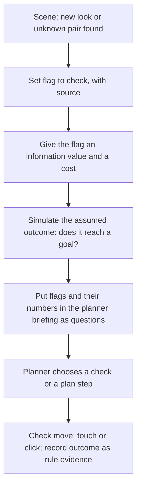

### 3.11 Depth 2: self, focus, and controller

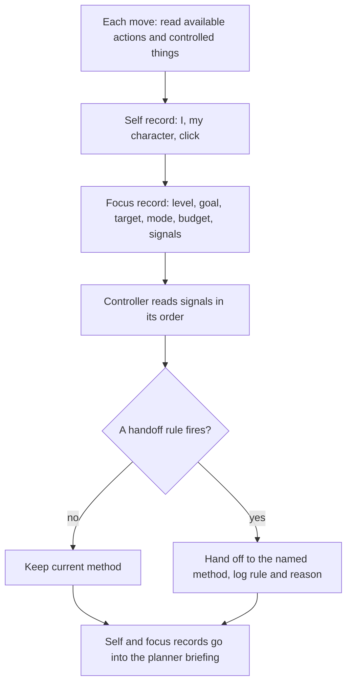

### 3.12 Depth 2: the planner (model-first performance)

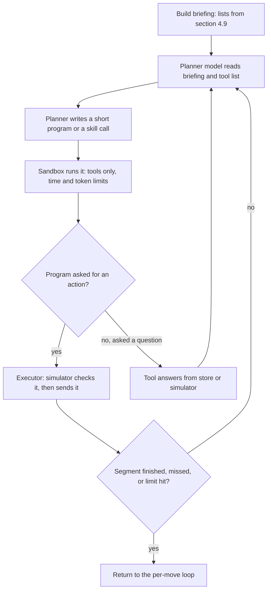

## 4. Modules, by section

Each module has a card: status, file, purpose, inputs, outputs, logic, stores, logs, tests.
The logic lines are the build contract. A line that says PLACEHOLDER is a value to set
(section 7).

### 4.1 Perception and scene

**Built modules**

- `arcagent/mind/screen.py` (built, keep). Palette and PNG rendering for review images.
- `arcagent/mind/objects.py` (built, keep). Things, scenes, diffs.
- `arcagent/mind/regions.py` (built, keep). Regions of the grid.
- `arcagent/mind/kinds.py` (built, keep). Identity of a thing across looks.
- `arcagent/mind/noise.py` (built, keep). Masks for counters and moving noise. Kameron,
  2026-10-30: "This seems useful for the new build."
- `arcagent/mind/modes.py` (built, changes). Selection marks and the active controller.
  Changes: its active-controller output becomes the source for "my character" (4.5).

**Not yet built**

- Flag labels for items (4.11).

**M1.1 Frame reader**

- Purpose: turn a frame into the observation the agent uses.
- Inputs: frame layers, game state, level counts, available actions.
- Outputs: grid (64 by 64, values 0 to 15, padding -1), phase, levels completed, levels to win, available actions.
- Logic:
  1. IF the frame has layers THEN the grid is the last layer, padded to 64 by 64 with -1.
  2. IF the frame has no layers THEN the grid is all -1.
  3. Phase is one of: not played, in play, won, game over.
- Stores: none.
- Logs: none (the observation is logged by the move record).
- Tests: a layer smaller than 64 by 64 keeps its values in the top-left and pads the rest with -1.

**M1.2 Scene builder**

- Purpose: find the things in the grid.
- Inputs: grid, the mask of noise cells.
- Outputs: a scene: a list of things, each with id, colour, shape, cells, and bounding box.
- Logic:
  1. Ignore noise cells (M1.4).
  2. Group connected cells of one colour into a thing.
  3. Cells that cover more than a quarter of the grid are background or terrain, not things.
- Stores: none.
- Tests: two touching squares of different colours make two things; a grid of one colour makes one background.

**M1.3 Tracker (identity over time)**

- Purpose: keep the same id for a thing across frames.
- Inputs: previous scene, new scene, the action taken.
- Outputs: the same ids, with new things given new ids.
- Logic:
  1. Match things of the same colour and shape across frames, nearest first.
  2. A thing that changed shape or colour keeps its id if its kind (M1.5) is the same.
  3. A thing with no match gets a new id and is marked new.
- Built from: `objects.py` tracker functions.

**M1.4 Noise mask**

- Purpose: find cells that change for reasons other than the agent's actions (counters, timers, animated backgrounds).
- Inputs: the history of frames on this level.
- Outputs: a set of noise cells, and any counter cells found.
- Logic:
  1. A cell that changes on most frames regardless of the action is noise.
  2. A thin strip whose size shrinks or grows one step per move is a counter (kept for the budget, M4.10).
- Built from: `noise.py`.

**M1.5 Kind (identity class)**

- Purpose: group looks that belong to one kind of thing.
- Inputs: a thing's look (colour, shape) and its history.
- Outputs: a kind id.
- Logic:
  1. A new look is matched to an existing kind if it shares shape and at least one behaviour seen so far.
  2. Otherwise a new kind is created.
- Built from: `kinds.py`.
- Note: the kind is what cross-game rules use (4.2). A look is only the first thing a rule sees.

**M1.6 Mode reader (selection and active controller)**

- Purpose: find what is selected, and which thing the agent is moving.
- Inputs: the previous and current scene, the action, the clicked thing if the action was a click.
- Outputs: the selected thing (if any), the active controlled thing (if any).
- Logic: as built in `modes.py` (a selection mark appears on a clicked thing and vanishes on a second click; the active controlled thing is the one that moves after a non-click action when two or more controlled things exist).
- Change: the output feeds the self record (4.5), not only the facts.

### 4.2 Memory

Memory has five record types and four stores. The records are the same shape across
stores, so one rule can move between stores without being rewritten.

**Built modules**

- `arcagent/mind/facts.py` (built, changes). The current fact table is the start of the
  rule store. Changes: add scope, status, probability, and the canonical key (below).
- `arcagent/mind/goals.py` (built, changes). The goal book is the start of the hypothesis
  store. Changes: each goal gets a path probability (4.7).
- `arcagent/mind/fluid_sleep.py` (built, changes). Level-up bookkeeping. Changes: becomes
  the level consolidation step (4.12).
- `arcagent/mind/memory.py` (built, off path, dropped for this agent). Its working memory
  class is the LLM path's version. Replaced by the stores below.

**Not yet built**

- Long-term store (file or table, per game and across games).
- Sequence record store.
- Canonical key function.
- Rule and hypothesis records in one schema.
- Flag store (4.11).

**Record types (logic)**

- **Rule record.** Fields:
  - `id`: stable.
  - `kind`: object, action, event, or experience.
  - `statement`: the regularity in words, for the log.
  - `conditions`: what must hold for the rule to apply (for example, health above zero, or the object touching a wall).
  - `effect`: what happens, in the effect vocabulary of `facts.py`.
  - `status`: hypothesis or fact (section 4.2 status rules).
  - `confirmations`, `contradictions`: counts of observed cases.
  - `probability`: from 4.4.
  - `scope`: working (this game), or long (across games).
  - `key`: the canonical key (below).
  - `source`: observed, loaded from long-term, or agent-made label.
  - `created_level`, `created_game`, `last_revised`.
  - `harm`: none, or the kind of harm the rule's effect causes (4.10).
- **Canonical key.** A rule's key names the kind of the subject and the role of the action, never the colour index. Example of the form, not a value: (kind of thing, action role, event type). Two games with the same mechanic get the same key even if their colours differ. (Part 1, D1; kept.)
- **Sequence record.** Fields: `id`, `goal` (the hypothesis it serves), `moves` (ordered), `segment_of` (the level), `runs`, `successes`, `status` (live, or completed), `deterministic` (true when the sequence is a named skill, 4.9).
- **Hypothesis record.** Fields: `id`, `goal` (kind and targets), `path_probability`, `expected_value`, `status` (open, tried, failed, achieved), `fork_id` (if on a fork).
- **Flag record.** Fields: `thing_id`, `label` (check, or an agent label), `source`, `value`, `cost`, `outcome`. (4.11.)

**Stores and what they hold**

| Store | Holds | Lives | Cleared when |
|---|---|---|---|
| Working memory | Rule records for this game, hypothesis records, sequence records, flags, fork tree, adverse rules seen | One game | The game ends (won, stopped, or out of budget). Not on death. Not on level reset. |
| Level state | Scene history, tracker, noise mask, current level's plan | One level instance | A new level instance starts (death, reset) or the level is complete. The level model is rebuilt from working memory. |
| Long-term store | Rule records with scope long, sequence records with scope long, the index | Across games and runs | Never cleared. Only records are retired (status retired). |
| Log | Move records, level and game summaries | Per run, on disk | Never. |

**Status rules (logic)**

1. IF a rule is created from one observation THEN status is hypothesis.
2. IF a hypothesis meets the promotion test (4.4) THEN status is fact.
3. IF a fact is contradicted AND a new condition explains the contradiction THEN the rule is refined: the condition is added, the counts are kept, status becomes hypothesis again until it meets the promotion test with the new condition.
4. IF a fact is contradicted AND no condition explains it THEN the rule's probability drops (4.4), and status goes to hypothesis.
5. IF the probability is in the low band (4.4) THEN status is retired. The record is kept.

Kameron's example, 2026-10-30, is the test for rules 1 to 4: "if the player touches an
enemy and dies instantly, that's a hypothesis; then the player touches an enemy and dies
after 2 seconds, that's still a hypothesis but the rule is updated; then the player dies
after touching the enemy for 5 seconds, the rule is updated to enemies kill if touched but
only the player dies after hit points drop to 0." In the rule record, that is one rule
refined twice: first with a time condition, then with a health condition. It is never
deleted.

**Clear rules (logic)**

1. IF a game ends THEN working memory is cleared, after the game consolidation (4.12) has written what is promoted.
2. IF a level instance ends by death or reset THEN level state is cleared and working memory is kept.
3. IF a level is completed THEN level state is cleared, working memory is kept, and the level consolidation (4.12) runs.
4. Long-term records are never cleared by a game ending.

Logs: every create, refine, promote, contradict, retire, and clear writes a log event with the record id.

Tests:
- The Kameron example above, as a fixture: three observations, two refinements, one rule id throughout.
- A game death keeps working memory: a rule learned before the death is still present after the death.
- A game end clears working memory and keeps long-term records.

### 4.3 Retrieval and index

**Built modules**

- `arcagent/mind/facts.py` (built, changes): exact-key lookup, a table of contents by behaviour tag, and a sibling index by shape. The lookup order is fixed (first match wins). Changes: ranked by probability (below).

**Not yet built**

- Index over canonical features (all rule and hypothesis records).
- Ranking by probability.
- Real-time cut.

**M4.3 Retrieval**

- Purpose: find the rules most likely to be right for a situation, quickly, without reading every record.
- Inputs: a query: the canonical features of the situation (kinds present, action role, event types of interest, the goal kind).
- Outputs: a ranked list of records, each with its probability of being correct.
- Logic:
  1. For each feature in the query, read its posting list from the index. The index maps each feature to the record ids that carry it.
  2. The candidate set is the union of posting lists, and each candidate's score counts how many query features it matches.
  3. Each candidate's probability is its probability from 4.4. Kameron, 2026-10-30 (Q3): the learned scorer is a network, because it "will get better" as levels and games happen. So from the point the index holds 200 records (PLACEHOLDER), a small network reads the query's features and the candidate's features and outputs a second probability. The candidate's score is the mean of the two probabilities. Before 200 records, the score is the rule's probability alone.
  4. Compute the cut for this query (rule 5).
  5. Keep candidates whose probability is at or above the cut. Sort best first. Ties sort by the four-decimal probability, then by id.
  6. IF no candidate is kept THEN return an empty list. The caller uses exploration or asks the planner a question (4.9). Retrieval never scans the whole store without a log event. Each scan is logged.
  7. Safety bound: at most 50 candidates are returned, to bound time. This is a time bound, not a choice of how many to use.
  8. The cut is set in real time: cut = the larger of the medium-band floor (4.4) and half of the best candidate's probability. PLACEHOLDER: the half-of-best factor is a proposal for review (Kameron, 2026-10-30: "it must be established in real-time").
- Stores: reads working and long-term stores.
- Logs: query features, candidate count, cut, returned ids, probabilities.
- Tests:
  - Equivalence: the indexed result equals a full scan's result on recorded queries.
  - A query with no matching features returns empty and logs a scan event.
  - Tie order is stable.

### 4.4 Probability and validation

**Built modules**

- `arcagent/mind/facts.py` (built, changes): hits, misses, and status by threshold (solid after 5 agreeing observations, broken after 2 misses in a row).

**Not yet built**

- Probability from evidence, with bands.
- Probability for paths (4.7) and for adverse events (4.10).

**M4.4 Probability of a rule**

- Purpose: turn evidence into the likelihood that a rule holds.
- Inputs: confirmations and contradictions of the rule.
- Outputs: a probability between 0 and 1, reported to four decimal places.
- Logic:
  1. probability = (confirmations + 1) / (confirmations + contradictions + 2). This is the Beta mean with a flat prior, PLACEHOLDER prior.
  2. A new rule has probability 0.5.
  3. Bands: certain band is at or above 0.8. Medium band is from 0.3 up to 0.8. Low band is below 0.3. (Kameron, 2026-10-30: "tighten them to 0.8 and 0.3".)
  4. Probability is reported with four decimal places, so ties are rare (Kameron, 2026-10-31: "there won't be any ties if the probability uses 4 trailing decimals").

**M4.4b Promotion test (hypothesis to fact)**

- Purpose: decide when a hypothesis is a fact.
- Logic:
  1. IF confirmations since the last refinement are at least 5 (PLACEHOLDER) AND contradictions since the last refinement are zero AND the probability is in the certain band THEN promote.
  2. The promotion test counts only observations made under the rule's conditions. A refinement resets the count for the new conditions and keeps the old counts in the log.
  3. Kameron's definition, 2026-10-30: "validated just means that the rule is a fact rather than a hypothesis." So the test is about repeated, unbroken observation, not about a count alone.

**M4.4c Path probability**

- Used in 4.7. Kameron, 2026-10-30, answered "no" to the question whether the independence approximation (multiplying move probabilities as if they were independent) is acceptable. So the path probability is not that product.
- Logic (chain rule over the simulated states):
  1. Simulate the path one move at a time. At step i, the simulator is in a known state S(i-1).
  2. The probability of step i is the probability of the rule that predicts it, conditioned on S(i-1) by that rule's conditions (4.2). Rule probabilities are conditional on their conditions, so each factor already depends on the state it is evaluated in.
  3. Path probability = the product of these conditional factors, taken in path order.
  4. Two factors that come from the same rule in the same state are one fact, counted once.
  5. Where a step has no rule, its factor is the prior 0.5 and the path is marked uncertain in the log.
- Note: this is the chain rule, which is exact for the model the agent holds. It does not claim the moves are independent in the world. The calibration check (4.13) measures whether the model's path probabilities match the observed rates.

Tests:
- Probability moves toward the observed rate.
- A new rule is at 0.5.
- A rule at 0.79 is medium, at 0.81 is certain, at 0.29 is low.
- Two hypotheses with the same probability to four places cannot tie, by construction, unless their paths are equal.

### 4.5 Self, focus, metacognition, and controller

**Built modules**

- `arcagent/mind/modes.py` (built, changes). Active controller.
- `arcagent/mind/progress.py` (built, keep). Milestone, progress, regress, motion, settled. These are signals for the controller.
- `arcagent/mind/indicator.py` (built, keep). Progress indicators. A signal for the controller.
- `arcagent/mind/budget.py` (built, keep). Moves left. A signal for the controller.
- `arcagent/agent/hybrid.py` (built, changes). The current switching rule (mind moves, stall count). Becomes the controller's first handoff rule. Its uncommitted stall rule must be benched first (as-built spec, section 2).

**Not yet built**

- Self record.
- Focus record.
- Controller as one module with a single owner of handoffs.
- Metacognition labels in the planner briefing.

**M4.5a Self record**

- Purpose: say who "I" is at each move, so the agent's own actions have one referent.
- Inputs: available actions, the controlled things (from 4.5 and 1.6), the last click.
- Outputs: `i` (always the agent), `my_character` (the controlled thing, or none), `click` (present or not).
- Logic:
  1. `i` is always the agent. (Kameron, 2026-10-30, answering Q2: "I would represent the agent manipulating those actions and the character is an extension of oneself." This changes the earlier source rule that said "I" is the mouse click when both exist. The change is recorded here for Kameron to confirm.)
  2. `click` is present IF action 6 is in the available actions. (Kameron, 2026-10-30: "Click present means exactly that, the action 6 is available.")
  3. `my_character` is the controlled thing IF one is identified, otherwise none.
  4. The self record is written to the planner briefing and to the decision code. (Kameron, 2026-10-30: the labels "should reach both since it might be talking to itself.")

**M4.5b Focus record**

- Purpose: say what the agent is doing right now, in one record.
- Outputs: level, goal and its status, target thing, mode (the branch that chose the last move), budget left, and the signal values.
- Logic: rewritten after each move. It is the first thing the planner briefing reads.

**M4.5c Controller**

- Purpose: decide when to change method, and say why.
- Inputs: the focus record, the signals, the gate state (4.10).
- Outputs: the method to use next (keep, switch goal, switch mode, reset fact breaks, re-probe a goal), and the reason.
- Logic:
  1. The controller reads its handoff rules in the order given in section 7 (order to be set after review of the workflow, Kameron, 2026-10-30: "Once you create it, we can answer that question").
  2. The first rule that fires wins. The rest are not checked for that move.
  3. Every handoff is logged with the rule name and the signal values.
  4. The controller does not run per level as a separate pass (Kameron, 2026-10-30: "the controller is meant for its purpose and not more").
- Handoff rules to be ordered (names only; the logic is in the cards that own the signals):
  - H-a: a gate tripped (4.10).
  - H-b: a plan broke at a miss that matters (3.6).
  - H-c: progress has stopped for N moves on the active goal (4.13 signal).
  - H-d: budget is low for the active hypothesis (4.13 signal).
  - H-e: the fallback count in a row is at the stall limit (as-built spec, STALL_MOVES).

**M4.5d Metacognition labels**

- Purpose: make the agent's own state visible to itself and to the planner.
- Logic: the focus record, the self record, and the list of open hypotheses are written into the briefing (4.9) at each planner call. The record of what the agent thinks it is doing (its branch and why) is part of the move log (4.13).

Tests:
- Self record: four fixtures (click and character, character only, click only, neither) give the expected `i`, `click`, and `my_character`.
- Controller: a fixture where two handoff rules would both fire gives the first one's name in the log.

### 4.6 Visual-spatial tools

**Built modules**

- `arcagent/mind/kinematics.py` (built, changes). `reachable` (forward search over positions the controlled thing can reach) and `field` (distance from each position to a target). Changes: shared breadth-first search with a truncation flag (below). Its walk currently stops at 4096 positions with no flag.
- `arcagent/mind/route.py` (built, keep, reason given below). Ordering of visits over several targets, exact up to 6 targets, then 2-opt.
- `arcagent/mind/search.py` (built, changes). Best-first search. Its heuristic is not guaranteed to be admissible. Changes: bounded by path probability (4.7).
- `arcagent/agent/explore.py`, `arcagent/agent/guided.py` (built, off path for the new agent, but the breadth-first search is a reuse source).

**Not yet built**

- A shared breadth-first search used by all callers (currently four copies).
- A truncation flag on every search.
- Jump point search: conditional (below).
- Theta-star: out of scope (below).
- Value estimation by Q-learning: new, gated (below).

**M4.6a Breadth-first search (shared)**

- Purpose: shortest move count over a graph of positions.
- Inputs: start, a neighbour function (the moves the agent can make from a position), a target test, a visit limit.
- Outputs: the path, the depth, and a flag: found, not found, or stopped at the limit.
- Logic:
  1. Visit positions in order of depth. Stop when the target is found or the limit is reached.
  2. Return the flag. An empty result is not the same as a truncated result.
- Replaces: the four copies in `kinematics.py` (two loops), `explore.py`, `guided.py`.
- Tests: equivalence with each current copy on the same inputs; a limit below the reachable area returns the truncated flag.

**M4.6b Route over targets (kept)**

- Purpose: the order to visit several targets in the shortest total path.
- Why it is kept: Kameron's example, 2026-10-30 (Q4 on the earlier spec), "pacman collects fruit then completes the level": a level with several collectible things needs an order, and this is the tool for it. Kameron, 2026-10-31: "I have no idea what route.py does or if its worth keeping." This section is the answer: it orders visits to collectibles and to goal-relevant things. It is kept.
- Logic: as built (exact for up to 6 targets, then nearest neighbour with 2-opt).

**M4.6c Best-first search**

- Purpose: find a plan toward a goal by predicting moves.
- Logic: as built, with two changes:
  1. Each expanded branch carries its path probability (4.4c). Branches below the probability floor (0.3, the medium-band floor, as a PLACEHOLDER floor) are not expanded further.
  2. Kameron, 2026-10-30 (Q1 admissible heuristic): an admissible heuristic is used only if it makes the agent take fewer moves and still complete levels. This is a measured choice (4.13), not a rule. Until measured, the current heuristic stays.

**M4.6d Jump point search (conditional)**

- Purpose: faster search on open grids with unit steps.
- Logic: built only if all three hold on recorded runs: (a) a game's learned moves are all unit steps; (b) search time is a large share of move time; (c) plan length matches breadth-first search. Otherwise not built.
- Why conditional: Part 4 (visual-spatial) gave this reason. The learned moves in these games can be multi-cell steps or slides, which the pruning rules do not cover.

**M4.6e Theta-star (out of scope)**

- Reason: the moves are discrete. Any-angle paths would contain moves the game does not allow. Revisit only if a game has continuous movement. Kameron, 2026-10-30 (Q2): "I have no idea because I don't see them, only the agent does." So the agent must check for continuous movement from observation (4.8 rule 6). Until it does, theta-star stays out.

**M4.6f Value estimation (Q-learning)**

- Purpose: a learned value for states or moves, used in the expected-value choice (3.4).
- Kameron, 2026-10-30: "Q-learning is a highly specialized math engine used to automate and optimize sequential decisions under deep uncertainty. Should help significantly with decision making."
- Logic:
  1. The value is a function of canonical features (not scene keys), so it generalises across games.
  2. It is trained from the agent's own moves, rewards being level completion, progress, harm, and the score.
  3. It is an input to the expected-value choice, not a replacement for it.
  4. Gate: built only after the rule store and the index (4.2, 4.3) exist and produce recorded transitions. Reason: with a few hundred moves per level, a value learned from scratch needs the shared features to learn anything across levels.
- Risk: tabular Q-learning over scenes will not converge in the move counts we have. The first version uses features and a small function approximator, measured against the plain expected-value choice (4.13).

Tests:
- Shared breadth-first search equals each current copy on fixtures.
- Route on 3 targets: the order's total length equals the exact minimum.
- Search: a branch below the probability floor is not expanded.
### 4.7 Hypotheses, forks, and planning

**Built modules**

- `arcagent/mind/goals.py` (built, changes). Goal guesses (reach, clear, count, cover, match, sequence) and the ranking formula. Changes: the ranking becomes path probability (below); the goal kinds stay.
- `arcagent/mind/search.py` (built, changes): see 4.6c.
- `arcagent/mind/fluid.py` (built, changes). The seven-step decision ladder. Changes: the ladder is replaced by the planning loop (3.2), with the same logging of branch and reason.
- `arcagent/mind/tester.py` (built, changes). Fact tests become curiosity checks (4.11).

**Not yet built**

- Hypothesis list ranked by path probability.
- Expected-value choice (3.4).
- Plan tree with forks, and the return route (3.6).
- Horizon rule (below).

**M4.7a Hypothesis list**

- Purpose: the ways to complete the level task, best first.
- Inputs: the rule store, the scene, the simulator (4.8).
- Outputs: a list of hypothesis records, each with its path probability and its path.
- Logic:
  1. Build goal hypotheses from the goal kinds that match the scene (goals.py guesses).
  2. For each goal, simulate the best path up to the horizon (4.8).
  3. Set the hypothesis's path probability (M4.4c).
  4. Sort by path probability, best first. Ties are rare by construction (four decimal places).
  5. A hypothesis with path probability below the floor (0.3, PLACEHOLDER) stays on the list but is not expanded.
  6. The list is rebuilt on each replan and not kept across replans, except its fork records.
- Kameron, 2026-10-31 (Q5 on the earlier spec): path probability alone ranks the list.

**M4.7b Expected-value choice**

- Purpose: choose which hypothesis to act on, when the best probability is not the best value.
- Logic: per hypothesis, from the simulated path:
  1. Expected moves = the expected number of moves to reach the goal along the path (the simulator returns the moves to each state, weighted by probability).
  2. Reward = the value of the goals it reaches. Goal kinds carry value from the level's score: completing the level has the largest value. Collectibles carry a value estimated from observed gains.
  3. Adverse cost = the probability of harm on the path times the cost of restarting from the last fork (moves to re-reach it).
  4. Expected value = reward times the path probability, minus the expected moves cost, minus the adverse cost.
  5. Expected moves cost uses the level's typical moves per completion (horizon rule below). Kameron, 2026-10-31 (Q1): "It should change to an expected value scoring because it will allow for less steps to identify the best plan."
  6. Choose the highest expected value. Ties by four-decimal path probability, then by id.
- Score link: the reward uses the scoring formula, `min(human/agent, 1)^2`. The human count is unknown at runtime, so the reward uses the typical moves per completion as the reference.

**Horizon rule**

- Kameron, 2026-10-31 (Q3): "it should follow each level's typical moves per completion."
- Logic:
  1. Horizon for a level = the mean number of moves the agent took on its completed attempts of that level, rounded up.
  2. Before the first completion of a level, horizon = PLACEHOLDER cap (initially 200), plus the time gate (4.10).
  3. A plan segment (3.5) is never longer than the horizon.
  4. The horizon is recorded per level in the long-term store.

**M4.7c Fork and plan tree**

- Kameron, 2026-10-31 (Q2): "a fork would be considered a plan or path that could go two ways toward the same goal. The agent would need to take the shortest path or least dangerous path, whichever is more favorable for the score."
- Logic:
  1. A fork is recorded when two or more paths to the same goal exist from the same state (the simulator finds more than one path).
  2. Each fork holds its state key, its paths ordered by expected value, and each path's status (untried, in progress, failed, achieved).
  3. Moves that led to the fork are kept on the fork record (Kameron, 2026-10-31 (Q3): "it should keep the moves that got there"). They are the return route.
  4. The return route to a fork is planned on the known moves (breadth-first search, 4.6a) and executed with the same check as any move.
  5. Replan order (3.6): newest fork with an untried path first, then older forks, then the root.
  6. Kameron, 2026-10-31 (Q4): "replan step" is the explorer's backtracking. So the explorer's backtracking is the rule for the return route, not a separate method.
  7. A failed path is marked failed for this goal instance (level instance). It is not retried in the same instance.

**Tests**

- Two-path fixture: the choice follows the expected value, not the probability alone.
- Fork return: after a dead end, the agent returns to the fork over known moves and takes the second path.
- A path below the floor is listed and not expanded.

### 4.8 Simulator (game model)

**Built modules**

- `arcagent/mind/predictor.py` (built, keep). `predict` is read-only (Kameron, 2026-10-30, answering Q1 on the earlier spec: "yes").
- `arcagent/mind/game_model.py` (built, off path, reuse). `play_out` simulates a plan step by step with `predict` and stops at a goal or at an unknown step. It is the LLM path's simulator. Reused as the base for 4.8's rollout.
- `arcagent/mind/kinematics.py` (built, changes): reachable positions and distances (4.6).

**Not yet built**

- Learned rules for uncontrolled movers (enemies and similar), for collectibles, and for adverse events.
- Probability on every predicted effect.
- Continuous-movement check.
- Rollout that returns probability, expected moves, and harm.

**M4.8a Rollout**

- Purpose: predict a path move by move, with probabilities, and stop at a goal, a harm, or the horizon.
- Inputs: the current scene and state (health, counters), a candidate move list, the rule store, the horizon.
- Outputs: the predicted states, each step's probability, the reached goal (if any), the harm events on the path, the stop reason.
- Logic:
  1. Start from the current scene and state.
  2. For each move i up to the horizon:
     1. Find the rules that predict this move from the current state (4.3).
     2. Apply the rule with the highest probability to each thing it covers. Things with no rule are predicted to stay still, and this is logged as an assumption (rule 4).
     3. Record the step's probability (M4.4c).
     4. Apply harm: if the state's health goes to zero, stop with a death. If an adverse event is predicted, record it with its probability.
     5. If a goal holds in the predicted scene, stop with goal reached.
  3. Return the outputs.
- Logs: every assumption and every harm is logged with the step number.

**M4.8b Learned movers (enemies and similar)**

- Purpose: predict things that move on their own.
- Kameron, 2026-10-30 (Q4): "I have been using that as an example and you are supposed to draw from that concept and not explicitly. This way if it has enemies then it can avoid them but if it has collections like pacman collects fruit then it can go for those before it completes the level."
- Logic:
  1. A thing that moves when the agent does nothing is a mover of its own. Its motion is learned as a rule with the thing's kind as subject.
  2. A mover's motion is predicted by its learned rule. Until a rule exists, the mover is predicted still, and each such prediction is logged as an assumption.
  3. A mover that the agent meets and that reduces health on contact is given the harm role (4.10).
  4. A thing that disappears on contact and changes a counter is given the collectible role. Its value is estimated from observed gains.
  5. The role is inferred from observed effects. No role is named after a game.
- Kameron, 2026-10-31, answering Q4 on the earlier spec (whether enemies exist in the games): "I have no idea." So the first build does not assume either exists.

**M4.8c Continuous movement check**

- Purpose: find out whether a game moves things by amounts that are not the learned step.
- Logic:
  1. For each moved thing, compare its displacement with the learned step size of its moves.
  2. IF displacements are not multiples of the step, for a run of moves THEN flag continuous movement for this game. The flag is logged and the theta-star question is reopened (4.6e).
- Kameron, 2026-10-30 (Q2): "I have no idea because I don't see them, only the agent does." So this check is what answers the question.

**M4.8d Horizon and assumptions in the log**

- Every rollout logs its horizon, the number of assumed-still predictions, the number of harm events predicted, and the number of predictions that later missed.

Tests:
- Rollout on a fixture with a known mover: the predicted scene matches after each step.
- A mover with no rule is predicted still, with an assumption logged.
- A predicted death stops the rollout with the death as the stop reason.

### 4.9 Planner and performance (model-first)

This is the change Kameron asked for. The planner is a language model with access to
skills and tools. It writes the next short segment of moves, and the executor checks each
move against the simulator.

**Built modules**

- `arcagent/mind/contract.py` (built, off path, reuse). Parses the model's reply into goals and plan steps, with checks for legal action ids. Reused for the planner's reply format.
- `arcagent/mind/sandbox.py` (built, off path, keep). Runs a generated program with time and memory limits. Kameron, 2026-10-30 (Q4 on the earlier spec): the code path "should replace the action part of it." So the sandbox is kept as the runner for planner programs.
- `arcagent/mind/turn.py`, `vchat.py` (built, off path). Prompt building and the vision chat. Reuse: the briefing builder in 4.9 takes its formatting and length limits from turn.py. vchat is kept only if the planner is given the screen image (decision in section 7).
- `arcagent/mind/assign.py` (built, off path). Hungarian assignment, which the planner does not need as written here. Kept as reference.
- `arcagent/mind/executive.py` (built, off path, not reviewed for this spec). Its role is not assessed here. Review before any reuse.
- `arcagent/mind/llm_drive.py`, `drive.py`, `toolbox.py`, `tool_fix.py` (built, off path). The DRIVE path. Its lessons (repair turns, toolbox fixes) are reference for the skill library. Not reused as code in this spec until reviewed.

**Not yet built**

- Briefing (the lists the planner reads).
- Tool API (what the planner may call).
- Question library.
- Skill library with deterministic strategy skills.
- Executor check (each act checked against prediction).
- Token and time gates for the planner (4.10).

**M4.9a Briefing**

- Purpose: give the planner the state in fixed lists, so it does not reread the game.
- Lists, in this order (each list has a fixed length limit, PLACEHOLDER per list, and is truncated from the least recent end):
  1. Current state list: each thing on screen, with its kind, its known rules, and its role (harm, collectible, blocker, mover, controlled).
  2. Action list: the valid action ids, and whether click is present (4.5a).
  3. Goal list: the level goal and the game goal, with status.
  4. Task list: the ordered tasks from the chosen hypothesis.
  5. Level rule list: rules for this level, by object, event, experience.
  6. Game rule list: rules for this game.
  7. Hypothesis list: top hypotheses with probability and expected value.
  8. Sequence list: the current segment and its status.
  9. Fork list: open forks and their untried paths.
  10. Flags: items marked check, with value and cost.
  11. Self record and focus record (4.5).
  12. Recent events: the last few move results with predicted and observed.
- Logic: the briefing is built from the stores (4.2) and the simulator (4.8). It is never built from the planner's own past reply, so the planner cannot repeat its own error as fact.

**M4.9b Tool API**

- Purpose: the only things the planner may call.
- Tools:
  - `simulate(moves)`: rollout from the current state (4.8a). Returns probability, expected moves, harm, stop reason.
  - `probability(rule_id)`: the probability and status of a rule.
  - `query(features)`: retrieval (4.3).
  - `route(targets)`: order of visits (4.6b).
  - `shortest(from, to)`: breadth-first search over known moves (4.6a).
  - `skill(name, args)`: a strategy skill (below).
  - `ask(question_id)`: a question from the question library (below).
  - `act(action)`: send one move. Only through the executor (M4.9d).
- Rule: the planner may simulate as often as it needs. The time gate (4.10) and the token gate bound the total.

**M4.9c Question library**

- Purpose: Kameron, 2026-10-30 ("You can propose questions to it so it decides quicker instead of telling it what to do"). The planner answers questions; the code does not tell it what to do.
- Questions (each returns a short structured answer from the stores or the simulator):
  - Q-BLOCK: what blocks the path to the goal, and is it harmful, a blocker, or a mover?
  - Q-REWARD: which things in view are goals or collectibles, and what is each one's value?
  - Q-HARM: what harm does the path carry, and at what step, with what probability?
  - Q-FORK: which open forks exist, and which untried path is best by expected value?
  - Q-CHECK: which flagged item gives the most information for the fewest moves?
  - Q-SAFE: can the agent survive the path to the next fork with the current health?
  - Q-UNKNOWN: which rule or thing has no rule, and how many times has it been seen?

**M4.9d Strategy skills (deterministic approaches)**

- Kameron, 2026-10-30 (Q1 on the sequence): part of a sequence "could be deterministic approaches like 'enemy blocks path, then kill it' or 'pitfall blocks path, then replan route around it'."
- A skill is a named approach with a trigger on kinds and events, and a fixed set of steps the executor can run. A skill never names a game.
- Skill list (first version):
  - S-ATTACK: trigger: a harm-role thing blocks the path. Steps: simulate the attack path; if the health after the attack stays above zero with margin, take the attack path; else go to S-AROUND.
  - S-AROUND: trigger: a harm-role or blocker thing blocks the path. Steps: find a route to the goal that avoids the thing's cells (breadth-first search, 4.6a), simulate it, take the best by expected value.
  - S-REPLAN-PIT: trigger: a hazard that causes a reset lies on the path. Steps: mark the hazard cells as harm, replan the route around them.
  - S-COLLECT: trigger: collectible things are in view and the goal is not closer. Steps: order collectibles by route (4.6b), simulate, add them to the path if the expected value rises.
  - S-WAIT: trigger: a mover blocks the path. Steps: wait the number of moves its learned rule predicts for it to clear; if no rule, S-AROUND.
  - S-EXPLORE: trigger: no hypothesis has a path. Steps: take the flagged check with the highest value per cost (4.11).
- Logic: the planner may pick a skill or write its own segment. A skill's steps still pass through the simulator and the executor. A skill that fails is marked failed for this level instance.

**M4.9e Executor**

- Purpose: send moves to the game, and check each one.
- Logic:
  1. Take the next move of the segment.
  2. Simulate it from the current state (one step).
  3. Send it to the game.
  4. Observe. Compare the observed scene with the predicted one (4.12a).
  5. IF they match THEN continue the segment.
  6. IF they miss and the miss matters (4.10 rule on mattering) THEN stop the segment and go to fork handling (3.6).
  7. IF they miss and it does not matter THEN log it, learn from it (4.12a), and continue.
- A move that is not in the segment is not sent. That is what keeps the planner from oscillating between two tiles: the segment is written once, checked, and executed in full before the next planner call (Kameron, 2026-10-31).

**M4.9f Planner call**

- Logic:
  1. A planner call is made when a segment is needed (replan, level start, segment done).
  2. The briefing (M4.9a) is built, and the planner is asked for one segment: up to horizon moves, or one skill call, plus one question if it needs more.
  3. The sandbox runs the reply's program with the tool API only. The sandbox stops at the time gate or the token gate (4.10).
  4. The segment is passed to the simulator (3.5). If the simulator finds it unsafe, the planner is asked once more with the failed step noted.
  5. A second failure drops the hypothesis (3.5).
  6. Each call's briefing, reply, and outcome are logged with the planner call id.

Tests:
- A fixture where the planner's segment passes the simulator: it is executed in full.
- A fixture where the planner's segment fails at step 3: the second call names step 3.
- S-ATTACK on a fixture with enough health: attack path taken; on a fixture without: S-AROUND taken.

### 4.10 Harm, inhibition, perseverance, and gates

**Built modules**

- `arcagent/mind/tester.py` (built, changes). `veto` gives reasons (game over, no effect, undoes progress). Changes: its reasons become adverse rules (4.10c).
- `arcagent/mind/fluid_modules.py` (built, changes). The Inhibition protocol. Changes: its real module becomes the rule store plus the network (4.10c).
- `arcagent/mind/budget.py` (built, keep). Moves left in a game with a counter. Used by the gates.
- `arcagent/mind/modules/inhibition.py` (built, off path, dropped in favour of the new inhibition). Kameron: "This won't be needed in this current agent." Dropped.
- `arcagent/mind/modules/` (other files) (built, off path). `base.py` (the protocols) is kept as a reference for the module interfaces.

**Not yet built**

- Harm definition module.
- Adverse rules (in the rule store).
- Inhibition network.
- Perseverance rule.
- Time gate per move, and LLM token gate.

**M4.10a Harm definition**

- Kameron, 2026-10-30 (Q3): "if the player has a health bar, then anything that reduces it. If no health bar, then anything that kills the player to restart from the beginning of the path or ends the level/game."
- Logic:
  1. IF a health bar is found (a counter that falls and never rises, found by the noise and counter logic, M1.4) THEN harm is any move after which the bar is lower.
  2. ELSE harm is any move after which the level instance ends by death, or the level or game ends.
  3. Health is tracked in the simulator's state. Where a health bar exists, the simulator carries its value. Where none exists, health is the implicit number of harms the path can take, which is 1.

**M4.10b Adverse rules and the network**

- Kameron, 2026-10-30 (Q2 on the earlier spec, build the network now or later): "There is no held out games so it must be built now. Inhibition rules are added as levels and games progress."
- Logic:
  1. Each adverse effect the agent observes is a rule (4.2) with a harm value (4.10a).
  2. The inhibition network is a small learned function, updated online. Its inputs are the canonical features of the situation and the action. Its outputs are a probability for each harm kind.
  3. Training data are the agent's own observed transitions, from every game the run has played so far. Nothing is tuned on a named game (constraint C1).
  4. The probability used for a move: IF the adverse rule for the move has at least 5 confirmations (PLACEHOLDER) THEN use the rule's probability (4.4) ELSE use the network's output.
  5. Rules are added as levels and games progress (Kameron's words). The network does not replace them, and it is retrained on the rule store's evidence.
  6. Network size: small enough to run in a move's time gate. PLACEHOLDER: a few hundred weights. Architecture chosen in the build, to be recorded in the log.

**M4.10c Perseverance**

- Kameron, 2026-10-30, with the 2026-10-31 clarifications: the simulator decides, and either reason can allow a medium-risk move.
- Logic (applies to medium-band adverse probability only, from 0.3 up to 0.8):
  1. Reason A: no other path to the goal exists without the move (the simulator finds none in the horizon). IF true THEN allow with reason logged.
  2. Reason B: the expected value of the path with the move is higher than without it (4.7b). IF true THEN allow with reason logged.
  3. Either reason is enough. Neither is required with the other.
  4. The simulator checks that the agent survives to the next fork or the goal. Kameron's fire example, 2026-10-31: walking through fire is allowed if the simulator shows the agent reaches the enemy with enough health to win the fight; avoiding the fire then leaves the agent with less health at the enemy.
  5. A move in the certain band (0.8 and up) is never allowed by perseverance (3.9).
  6. A move in the low band (below 0.3) is allowed without a reason.
  7. Each allowed medium-risk move is a trial. Its outcome updates the probability (4.4). The count of trials per rule per level instance is capped (PLACEHOLDER: 3).
- Kameron, 2026-10-31 (Q5 on the earlier spec): "Its using the simulator before it makes a real move, so it shouldn't be a problem." So override trials do not need a separate budget charge, because the simulator checks them first.

**M4.10d Gates**

- Kameron, 2026-10-30 (Q1 on the earlier spec): "The time game should be per move so the agent doesn't spend all its time trying to figure out one move."
- Kameron, 2026-10-30 (Q2): "It should count the LLM tokens only. This will prevent the LLM from spending too many tokens to overbuild on one move."
- Logic:
  1. Time gate: the wall-clock time for one move, from observation to sending the action, is capped at T_MOVE (PLACEHOLDER: set from the measured median move time, times a factor). If the cap is reached, the move is the fallback in 4.10e.
  2. Token gate: the LLM tokens spent on one move (planner and any other model call) are capped at N_TOKEN (PLACEHOLDER). If the cap is reached, the planner returns what it has, and the move is the fallback.
  3. Run gate: each game gets a share of the 9-hour run, equal to an even share of the time left over the games still to play (existing `fair_share` rule in `submit.py`).
  4. Every trip writes a log event with the gate name and the values.
- Fallback (4.10e): the move with the highest simulated expected value among the moves the simulator allows, or, if the simulator has none, the explorer's least-visited move (the explorer is kept as the fallback, as-built section 4).

Tests:
- The fire example as a fixture: the planner chooses the fire path when the simulator shows the enemy is reached with enough health.
- The certain band is never allowed, even for an expected value gain.
- A move over the time gate takes the fallback and logs the trip.

### 4.11 Curiosity

**Built modules**

- `arcagent/mind/tester.py` (built, changes): `choose_test` and its use of unknown pairs. Changes: tests become checks (below).
- `arcagent/mind/modules/voi.py` (built, changes): disagreement measure, used as the information value of a check.
- `arcagent/mind/search.py` (built): the frontier of unknown pairs is reported with the search result.

**Not yet built**

- Flag store and flag records.
- Agent-made labels.
- Checks as moves chosen by the planner.

**M4.11a Flags**

- Kameron, 2026-10-30 (Q1 on the earlier spec): "I won't tell the agent anything, it will have to derive it on its own so it should allow designer labels that it can create."
- Logic:
  1. A flag is set to check when a thing has a new look (kind not seen before) or when a pair (action, thing) has no rule (a frontier pair).
  2. The agent may create its own labels for things. A label is a short name the agent makes for a kind or a role (for example, a name for a thing that stopped it). Labels are stored with the rule that gave rise to them, and the planner reads them in the briefing.
  3. A flag keeps its source and its outcome after the check.

**M4.11b Checks**

- Logic:
  1. A check is a move that touches or clicks a flagged thing.
  2. The check's value = the number of unknown pairs it resolves (Voi, 4.11c) plus the value of the goal the thing is part of, if any.
  3. The check's cost = the moves to reach the thing (breadth-first search) plus one.
  4. The simulator projects the assumed outcome. A check whose assumed outcome reaches a goal in a few moves is marked.
  5. The planner chooses a check or a plan step, with the numbers in its briefing. The code does not force the choice (Kameron, 2026-10-30: "I will let the LLM decide on the checks on its own.").

**M4.11c Information value**

- Logic: value of a check = how far the check's outcome would change the probability of the hypotheses that depend on it. Built as the disagreement measure in `voi.py`. PLACEHOLDER: the weight given to goal value.

**Social check**

- Dropped. Kameron, 2026-10-30 (Q2 on the earlier spec): "No social check. There are no other players."

Tests:
- A new look sets a flag to check with source new look.
- A check on a thing that changes a rule records the outcome and clears the flag.
- The planner briefing lists flags with value and cost.

### 4.12 Learning and consolidation

**Built modules**

- `arcagent/mind/goals.py` (built, keep): `learn_win` (credit for the gaps the winning move closed) and `generalize_forms` (carry forms to colours).
- `arcagent/mind/facts.py` (built, changes): `learn` writes evidence from each transition.
- `arcagent/mind/fluid_sleep.py` (built, changes): level bookkeeping. Changes: becomes the level consolidation below. Its time cap stays.
- `arcagent/mind/sleep.py` (built, off path, dropped). Kameron, 2026-10-30: "This seems like it would only be useful between games to consolidate, dedupe, and add learnings but I would not keep this because it overcomplicates things currently." Dropped. Its between-game job is taken by 4.12c.
- Transfer (`modules/transfer.py`, `CarryTransfer`) (built, keep): carries working memory across level instances.

**Not yet built**

- Long-term consolidation at game end.
- Promotion of rules to long-term scope.
- First-contact evaluation (below).

**M4.12a Transition learning (per move)**

- Logic: as the learning diagram (3.7). Every move is learned from. Learning happens after the check, never before the planner's next call.
- Each update is logged with the rule id.

**M4.12b Level consolidation (at level complete)**

- Logic:
  1. For each rule with scope working that meets the promotion test (4.4b) and whose conditions are general (they name kinds and roles, not this level's colours), set scope long.
  2. Write the completed sequence record for the level (status completed).
  3. Store the level's typical moves (the horizon, 4.7).
  4. Clear the level state. Keep working memory.
  5. Start the next level instance.

**M4.12c Game consolidation (at game end)**

- Logic:
  1. Write every rule with scope long, and every completed sequence, to the long-term store.
  2. Rebuild the index for the long-term store (4.3).
  3. Write the game summary to the log.
  4. Clear working memory.
- Kameron, 2026-10-30 (Q2 on the earlier spec): "Long-term memory is allowed to update during a scored run." So steps 1 and 2 also run at each level completion, not only at game end. The game-end pass is the final write.

**M4.12d First-contact evaluation**

- Purpose: measure learning on games the agent has not used for tuning, without a held-out set.
- Logic:
  1. Games are played in a fixed order set by the run seed.
  2. Each game's first attempt is scored with a long-term store built from the games before it in the order only.
  3. The first-contact score is the mean of those first attempts.
- Status: a proposal from this spec, not a Kameron decision. Flagged in section 7.

Tests:
- Consolidation promotes a rule that meets the test and does not promote one that does not.
- A game end clears working memory and writes the long-term store.
- The first-contact order never includes the game being scored in its own store.

### 4.13 Runtime, logging, and evaluation

**Built modules**

- `arcagent/mind/runlog.py` (built, keep). JSONL run log with event names.
- `arcagent/agent/submit.py` (built, changes). Builds the arcade, selects games, builds one policy per game, writes the submission file. Changes: the new agent's configuration is one entry in the policy table.
- `arcagent/mind/config.py` (built, keep). Configurations and ablations. The ablation approach (null modules) is kept.
- `arcagent/agent/hybrid.py` (built, changes): see 4.5c.

**Not yet built**

- The move record fields below, complete.
- Calibration report.
- First-contact score report.
- Gate report.

**M4.13a Move record**

- Written for every move. Fields:
  - `game`, `level`, `level_instance`, `move_index`, `stage` (framing, objectives, alternatives, modeling, execution, evaluation, or a named sub-stage).
  - `self` and `focus` records (4.5).
  - `hypothesis_id`, `segment_id`, `fork_id`, `planner_call_id`.
  - `predicted`: the predicted scene's key, the step's probability, and any harm predicted.
  - `observed`: the observed scene's key, and whether it matched.
  - `rules_updated`: list of rule ids with their change (confirm, contradict, refine, promote, retire).
  - `gate`: time spent, LLM tokens spent, and any trip.
  - `branch` and `reason`.

**M4.13b Summaries**

- Level summary: moves, deaths, forks, replans, rules created, promoted, refined, retired, planner calls, tokens, time.
- Game summary: levels, scores, first-contact result, long-term store size, gate trips.

**M4.13c Reports**

- Calibration: predicted probability against observed rate, in bins of 0.1. Per rule kind.
- Moves against typical: moves per level against the level's typical count (4.7).
- Gate trips per game.
- First-contact score (4.12d).
- Inhibition hit rate: moves the network or rules vetoed, and how often the veto would have been an adverse event (from the simulator's projection).

Tests:
- Every move has a record with each field present.
- A calibration fixture where predictions are right half the time reports bin 0.5 at about 0.5.
## 5. Reuse map

Every built module, what v2 does with it, and the section that decides it. "Keep" means the
contract stays. "Change" means the contract or use changes. "Off path" means it is not used
by the new agent. "Drop" means Kameron decided it is not part of the agent.

| Module | Status | v2 decision | Section |
|---|---|---|---|
| `core/frames.py`, `core/types.py` | Built | Keep | 4.1 |
| `mind/screen.py` | Built | Keep (review images) | 4.1 |
| `mind/objects.py` | Built | Keep | 4.1 |
| `mind/regions.py` | Built | Keep | 4.1 |
| `mind/kinds.py` | Built | Keep | 4.1 |
| `mind/noise.py` | Built | Keep (Kameron: "useful for the new build") | 4.1 |
| `mind/modes.py` | Built | Change: active controller feeds the self record | 4.1, 4.5 |
| `mind/facts.py` | Built | Change: becomes the rule store (scope, status, probability, canonical key) | 4.2, 4.3, 4.4 |
| `mind/goals.py` | Built | Change: goal guesses kept; ranking by path probability; `learn_win` and `generalize_forms` kept | 4.2, 4.7, 4.12 |
| `mind/predictor.py` | Built | Keep: read-only (Kameron, yes) | 4.8 |
| `mind/game_model.py` | Built, off path | Reuse as the base of the rollout | 4.8 |
| `mind/kinematics.py` | Built | Change: shared breadth-first search and truncation flag | 4.6 |
| `mind/route.py` | Built | Keep: orders visits to collectibles and goals | 4.6 |
| `mind/search.py` | Built | Change: bounded by path probability; heuristic change only if measured | 4.6 |
| `mind/tester.py` | Built | Change: checks and adverse reasons | 4.10, 4.11 |
| `mind/fluid.py` | Built | Change: decision ladder becomes the planning loop | 3.2, 4.7 |
| `mind/fluid_modules.py` | Built | Change: the four paper modules stay as ablation points; Inhibition becomes rules and the network | 4.10 |
| `mind/fluid_sleep.py` | Built | Change: becomes level consolidation | 4.12 |
| `mind/progress.py` | Built | Keep: signals for the controller | 4.5 |
| `mind/indicator.py` | Built | Keep: signals for the controller | 4.5 |
| `mind/budget.py` | Built | Keep: used by the gates | 4.5, 4.10 |
| `mind/baseline.py` | Built | Keep: the baseline explorer the hybrid uses | 4.5 |
| `mind/modules/voi.py` | Built | Change: information value of a check | 4.11 |
| `mind/modules/transfer.py` | Built | Keep: carries working memory across level instances | 4.12 |
| `mind/modules/base.py` | Built | Keep as reference for the module protocols | 4.10 |
| `mind/modules/inhibition.py` | Built, off path | Drop: "This won't be needed in this current agent" (Kameron) | 4.10 |
| `mind/modules/metacognition.py` | Built, off path | Off path; its role is the controller (4.5) | 4.5 |
| `mind/sleep.py` | Built, off path | Drop: "would not keep this because it overcomplicates things" (Kameron) | 4.12 |
| `mind/wisdom.py` | Built, off path | Drop: "This won't be needed in this current agent" (Kameron) | 4.9 |
| `mind/memory.py` | Built, off path | Drop: replaced by the stores in 4.2 | 4.2 |
| `mind/agent.py` | Built, off path | Drop: the program path's agent; replaced by the planning loop | 3.2 |
| `mind/sandbox.py` | Built, off path | Keep: runs planner programs (Kameron: the code path replaces the action part) | 4.9 |
| `mind/contract.py` | Built, off path | Reuse: parses the planner's reply | 4.9 |
| `mind/turn.py` | Built, off path | Reuse: briefing formatting and limits | 4.9 |
| `mind/vchat.py` | Built, off path | Decide: keep only if the planner reads the screen image (section 7, O3) | 4.9 |
| `mind/assign.py` | Built, off path | Reference only | 4.9 |
| `mind/executive.py` | Built, off path | Not reviewed; reference only | 4.9 |
| `mind/llm_drive.py`, `drive.py`, `toolbox.py`, `tool_fix.py` | Built, off path | Reference for the skill library; not reused as code until reviewed | 4.9 |
| `mind/synthesizer.py` | Built, off path | Not reviewed for this spec; reference only | 4.9 |
| `agent/hybrid.py` | Built | Change: switching rule becomes controller handoff H-e; stall rule benched first | 4.5 |
| `agent/explore.py` | Built | Keep as the fallback explorer; its backtracking is the return route rule | 4.6, 4.10 |
| `agent/guided.py` | Built | Reference: breadth-first search copy; the explorer's win-credit logic is reference | 4.6 |
| `agent/submit.py` | Built | Change: one policy entry for the new agent; `fair_share` kept | 4.10, 4.13 |
| `mind/runlog.py` | Built | Keep, extend fields (4.13) | 4.13 |
| `mind/config.py` | Built | Keep ablation approach | 4.13 |

## 6. Decisions from the review comments (2026-10-30 and 2026-10-31)

Kameron's comments are the authority for every row. All 43 comment threads on the earlier
spec are covered here. Threads are not activated for Claude, so no replies were posted
(section 7, O14).

**Memory (Part 1)**

| Question | Answer | Applied in |
|---|---|---|
| Q1 RESET after game over | Working memory is per game. Clear it when the game ends, not on a loss, so the memory can be used to replay. | 4.2 clear rules |
| Q2 Long-term update during a scored run | Allowed. | 4.12c |
| Q3 "Validated" | "Validated just means that the rule is a fact rather than a hypothesis." A rule starts as a hypothesis and is refined as observations arrive (the enemy example). | 4.2 status rules, 4.4b |
| Q4 Held-out game set | There is no held-out set. The 25 public games are observation only (C1). | 1 (C1), 4.12d |

**Retrieval (Part 2)**

| Question | Answer | Applied in |
|---|---|---|
| Q1 "Most probable" | A probability score: the likelihood the information is correct. Not age, not recency. | 4.3, 4.4 |
| Q2 k or threshold | Threshold, set in real time. No fixed k. | 4.3 rule 8 |
| Q3 Learned scorer | A network: it improves as levels and games happen, and later games are harder. | 4.10b (the network is built now), 4.3 |
| Q4 HCQM construct | 1.7. | 4.3 (the construct label for the retrieval module) |

**Metacognition and self (Part 3)**

| Question | Answer | Applied in |
|---|---|---|
| Q1 "Click present" | Action 6 is available. | 4.5a rule 2 |
| Q2 "I" on keyboard moves when a click exists | Yes. "I" is the agent manipulating the actions; the character is an extension of oneself. This changes the earlier source rule that made "I" the click in that case; O4 asks for confirmation. | 4.5a rule 1 |
| Q3 Self labels: prompt, decisions, or both | Both. "It might be talking to itself." Metacognition is supposed to do that. | 4.5a rule 4, 4.5d |
| Q4 Signal order | Set after the workflow is reviewed. | 4.5c rule 1, O2 |
| Q5 Controller per level | No. The controller is for its purpose only. | 4.5c rule 4 |

**Visual-spatial (Part 4)**

| Question | Answer | Applied in |
|---|---|---|
| Q1 Admissible heuristic | Only if it makes the agent take fewer moves and still complete levels. | 4.6c rule 2 |
| Q2 Continuous movement | Kameron cannot see it; only the agent does. The agent checks (continuous movement check). | 4.8c |
| Q3 Q-learning as policy or value estimate | Kameron's words: "a highly specialized math engine ... should help significantly with decision making." The spec takes this as a value estimate, gated after the store and index exist (risk stated in 4.6f). | 4.6f, O6 |
| Q4 `route.py` | "I have no idea what route.py does or if its worth keeping." Answered in 4.6b: it orders visits to collectibles and goals, so it is kept. | 4.6b |

**Planning (Part 5)**

| Question | Answer | Applied in |
|---|---|---|
| Q1 Expected-value rule | Yes: expected value scoring, because it needs fewer steps to find the best plan. | 3.4, 4.7b |
| Q2 Definition of a fork | A plan or path that could go two ways toward the same goal. Take the shortest or the least dangerous, whichever scores better. | 4.7c, 3.6 |
| Q3 Keep or replay moves to a fork | Keep them. The simulator covers them anyway unless unknown objects remain. | 4.7c rule 3 |
| Q4 Explorer backtracking as replan | Yes, the replan step. | 4.7c rule 6, 3.6 |

**Perform (Part 6)**

| Question | Answer | Applied in |
|---|---|---|
| Q1 One list per goal or per level | One list per level, so the agent acts in sequence. Parts of it can be deterministic, for example "enemy blocks path, then kill it" or "pitfall blocks path, then replan route around it." | 4.9d skills, 4.6 |
| Q2 Network now or later | Now: there is no held-out set, and inhibition rules are added as levels and games progress. | 4.10b |
| Q3 What counts as harm | A health bar: anything that reduces it. No health bar: anything that kills the player and sends it back to the path start, or ends the level or game. | 4.10a |
| Q4 Code path beside or replacing action performance | It replaces the action part. The agent moves to a model-first design with skills and tools. | 4.9 |

**Prediction (Part 8)**

| Question | Answer | Applied in |
|---|---|---|
| Q1 Strict read-only rule | Yes. The LLM uses a simulated model to check the next few moves and writes the next sequence before it remodels. This keeps it from oscillating between two tiles. | 4.8a, 4.9e, 3.5 |
| Q2 Independence approximation | No. | 4.4c (chain rule) |
| Q3 Horizon | Each level's typical moves per completion. | 4.7 horizon rule |
| Q4 Enemies that move on their own | Kameron does not know which games have them, and asks the agent to draw from the concept: avoid enemies, collect things like pacman's fruit before completing the level. | 4.8b |
| Q5 Ranking by path probability alone | Yes. Four trailing decimals mean no ties. | 4.4 rule 4, 4.7a rule 4 |

**Curiosity (Part 9)**

| Question | Answer | Applied in |
|---|---|---|
| Q1 Designer labels as well as derived flags | The agent derives flags itself. It may create its own labels. | 4.11a |
| Q2 Social check | No. There are no other players. | 4.11 (dropped) |
| Q3 Checks before the plan | The LLM decides on its own. Propose questions to it, so it decides faster instead of being told what to do. | 4.9c, 4.11b rule 5 |
| Q4 Owner of the planning loop | The agent's own planning. | 3.2 |

**Visual-spatial (Part 4) and grit (Part 7)**

| Question | Answer | Applied in |
|---|---|---|
| Grit Q1 Time gate scope | Per move, so no single move takes all the time. | 4.10d rule 1 |
| Grit Q2 Which tokens | LLM tokens only, to stop overbuilding on one move. | 4.10d rule 2 |
| Grit Q3 Probability bands | 0.8 and 0.3. | 4.4 rule 3 |
| Grit Q4 "No other way" reason | Either reason is enough: no other way, or the expected value beats the harm. Example: fire reduces health, so the agent can walk through it if the simulator shows it reaches the enemy with enough health. | 4.10c |
| Grit Q5 Override trials and the budget | The simulator runs first, so this is not a problem. | 4.10c |

**Schedule (Part 1 review)**

| Question | Answer | Applied in |
|---|---|---|
| Build-order cut | "11-1 is the last and final submission allowed." | 1 (final date), O1 |

**Module comments (section 2.2 of the as-built spec)**

| Module | Comment | Applied in |
|---|---|---|
| `wisdom.py` | "This won't be needed in this current agent." | Dropped (section 5) |
| `sleep.py` | "I would not keep this because it overcomplicates things currently." | Dropped (section 5) |
| `noise.py` | "This seems useful for the new build." | Kept (section 5) |

## 7. Open items

These need Kameron's decision or a measurement. Nothing in this list is decided by the spec.

- **O1. Final submission date.** Kameron's comment says 2026-11-01 is the last and final submission. The earlier project note said 2026-11-02 23:59 UTC. This spec uses 2026-11-01. Confirm against the competition page.
- **O2. Controller signal order.** Section 4.5c lists the handoffs without an order. Kameron set this question for after the workflow review. Order it after reading 3.11.
- **O3. Model and screen input.** The planner is a language model with open weights, offline. Two decisions remain: which model, and whether the planner reads the screen image (`vchat.py`) or the scene alone. The Host question on the eligibility of model-based entries is still open (as-built spec, section 1).
- **O4. Change to the "I" rule.** Section 4.5a rule 1 changes the source rule (the click is "I" when both exist). Kameron's comment says "I" is always the agent. Confirm.
- **O5. Meaning of "no" on independence.** Read here as "not acceptable," which the chain rule (4.4c) follows. Confirm.
- **O6. Q-learning scope.** The spec takes Kameron's remark as a value estimate, gated after the store and index. He did not answer the policy-or-value question in those words. Confirm, and accept the risk in 4.6f that tabular Q-learning will not converge at these move counts.
- **O7. Placeholders.** Set or measure each one. The list:
  - Promotion count: 5 confirmations (4.4b).
  - Certain band 0.8, medium floor 0.3, path floor 0.3 (4.4, 4.6c, 4.7a).
  - Retrieval cut factor: half of the best probability (4.3 rule 8).
  - Horizon cap before the first completion: 200 moves (4.7).
  - Time gate per move, and LLM token gate per move (4.10d).
  - Trials per rule per level for perseverance: 3 (4.10c).
  - Network size and the adverse-rule confirmation count of 5 (4.10b).
  - Briefing list lengths (4.9a).
  - Information value weight for goals (4.11c).
  - Skill margins for S-ATTACK (4.9d).
- **O8. Health without a health bar.** This spec sets implicit health to one harm (4.10a rule 3). Confirm.
- **O9. Collectible value.** Estimated from observed gains (4.8b rule 4). Confirm the source of the value.
- **O10. First-contact evaluation.** A proposal in 4.12d, not a Kameron decision. Accept or change.
- **O11. Build scope for 2026-11-01.** Section 8 lists the full build, which is weeks of work. The submission cut must be chosen with Kameron (section 8.2 gives a candidate).
- **O12. Unverified facts about the games.** Enemy presence, collectibles, continuous movement, and move counters differ by game. The agent must discover them. The spec does not assume any of them.
- **O13. Threads.** All 43 comment threads are not activated for Claude. Claude cannot reply to or resolve them. To get replies, Kameron can send a thread to Claude from the artifact page.

## 8. Build path

### 8.1 Dependency graph

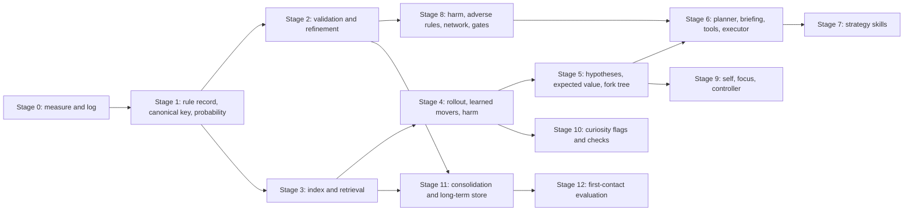

### 8.2 Stages, with acceptance tests

Each acceptance test is a logic fixture (section 4 tests). A stage is done when its tests
pass and its log fields (4.13) are written.

| Stage | Builds | Acceptance |
|---|---|---|
| 0 | Move record and level and game summaries (4.13). Gate values logged. | Every move writes a record with all fields. |
| 1 | Rule record, canonical key, probability, bands (4.2, 4.4). | Probability fixtures (4.4 tests); four-decimal ties cannot occur. |
| 2 | Status rules, refinement, promotion test (4.2, 3.7). | The enemy example (4.2 tests): one rule, two refinements, no deletion. |
| 3 | Index, retrieval, real-time cut (4.3). | Equivalence with a full scan on recorded queries; empty result logged. |
| 4 | Rollout, learned movers, harm definition, continuous check (4.8, 4.10a). | Mover fixture; death stop; assumptions logged. |
| 5 | Hypothesis list, expected value, forks, return route (4.7, 3.4, 3.6). | Two-path fixture chooses by expected value; fork return. |
| 6 | Briefing, tool API, question library, executor, planner call (4.9a to 4.9c, 4.9e, 4.9f). | Segment passes or fails the simulator; second call names the failed step. |
| 7 | Strategy skills (4.9d). | S-ATTACK with and without margin; S-AROUND as fallback. |
| 8 | Adverse rules, inhibition network, perseverance, time and token gates (4.10). | Fire example; certain band never allowed; gate trip logged. |
| 9 | Self record, focus record, controller (4.5). | Four self fixtures; first handoff rule named in log. |
| 10 | Flags, labels, checks (4.11). | New look sets flag; check records outcome. |
| 11 | Level and game consolidation, long-term store (4.12). | Promotion only for rules meeting the test; game end clears working memory. |
| 12 | First-contact evaluation and reports (4.12d, 4.13c). | Store never includes the game being scored; calibration fixture. |

### 8.3 Candidate cut for 2026-11-01 (for decision, not decided)

The full build cannot be finished in the time left. One candidate:

1. Keep the built hybrid, unchanged except that its uncommitted stall rule is benched first.
2. Add Stage 0 (logging) so the run is measured.
3. Add the two gates from Stage 8 that are cheap: the time gate per move and the LLM token gate.
4. Submit the hybrid, which is model-free and has benchmarks on record from 2026-10-28 and 2026-10-29 (experiment log). Those benchmarks are offline runs, and the scored result is not known until the run.
5. Start Stages 1 to 12 after the submission.

This candidate is a suggestion. The choice belongs to Kameron (O11).
