# Agent Specification v2: Process, Modules, and Build Path

Status: draft for review, 2026-10-31. Owner: Kameron. Prepared by Claude.
Supersedes the refactor parts (1 to 9) and the as-built section as the working spec. Those
documents stay as the record of the comparison. Every decision Kameron made in the review
comments of 2026-10-30 and 2026-10-31 is in section 6. Nothing here is built.

## 0. How to read this document

**Status labels on every module.**

- **Built.** The code exists and is on the current path. The file is named.
- **Built, changes.** The code exists. This spec changes its contract or its use.
- **Built, off path.** The code exists and is not on the current path. Section 5 says whether it is kept.
- **New.** No code exists. The spec describes it fully enough to build.
- **Dropped.** Kameron decided it is not part of the new agent (section 6).

**Workflow graphs.** Each process has a graph. Graphs come at three depths:

- **Depth 0.** The whole game, from start to end. Section 2.
- **Depth 1.** One stage of the depth 0 graph, for example the per-move loop. Section 3.1 to 3.4.
- **Depth 2.** A sub-process inside a stage, for example how a hypothesis is simulated. Section 3.5 onward.

In the graphs, rectangles are steps, diamonds are decisions, and rounded boxes are stores
(memory and logs). Arrows are the order of control. Labels on arrows give the condition.

**Logic, not code.** Each module is written as numbered rules of the form IF condition
THEN result, plus its inputs, outputs, stores, and tests. The rules are the contract.
Implementation picks the data structures. Where a number is a placeholder, it is marked
PLACEHOLDER and listed in section 7.

**Terms.**

- **Scene.** The objects on screen at one moment, with their colours, positions, and kinds.
- **Move.** One action sent to the game. A click is a move.
- **Level instance.** One attempt at a level. A death or a reset starts a new level instance
  of the same level. Working memory belongs to the game, not to the level instance.
- **Rule.** A stated regularity about objects, actions, events, or experiences. It has a
  status: hypothesis or fact (section 4.2).
- **Hypothesis (goal hypothesis).** One way to complete a level task, with a probability.
  Different from a rule hypothesis, which is a candidate regularity. The text says which.
- **Sequence.** An ordered list of moves that serves one task.
- **Fork.** A point where the agent can reach the same goal by two or more paths
  (Kameron, 2026-10-31: "a plan or path that could go two ways toward the same goal").

## 1. Scope, goals, and constraints

**Goal.** An agent that completes levels in games it has not seen, by learning how the game
works from play, and that can show this learning is real. Kameron's words: the agent "must
have true learning and fluid intelligence capabilities."

**Scoring.** Per level, the score is `min(human_actions / agent_actions, 1)^2`
(`docs/agent-submission.md`). The game score weights levels by level index, and the total is the
mean over games. The agent never reads the human action counts at runtime. The counts exist
in the local game metadata (`baseline_actions`) and the scorer uses them. So every "moves
per level" target in this spec is an estimate the agent builds from its own completions
(section 4.8, horizon rule).

**Runtime and environment.** 110 private games. 9 hours of runtime. No internet during the
run. Offline model weights must be open (competition rules, section 6 of the rules as pasted
2026-10-29). Each level gives a move counter in some games and none in others.

**Constraints that govern every module.**

- **C1. No tuning on the public games.** The 25 public games are observation only. Their logs
  show gaps in learning, intelligence, and code. They are never used to pick a threshold,
  a move, or a rule for a named game (Kameron, 2026-10-30: "games should not be used for
  tuning ... We can use the played games as observations to understand gaps").
- **C2. No hard-coded moves and no per-game answers.** No module names a game, a level, or a
  sprite. Rules come from observation.
- **C3. Concepts are learned, not coded.** Mechanics are learned as rules. The agent should
  combine learned concepts (for example, jump plus run gives a running jump). Where a
  general strategy is written down, it is a skill with a trigger on object and event kinds
  (section 4.9), not a rule for one game.
- **C4. The model decides, the simulator checks.** The language model proposes plans. The
  simulator predicts each plan before a real move. The executor checks each real move against
  the prediction (Kameron, 2026-10-31: the LLM "uses a simulated model of the game to check
  the next few moves and then ... write the next few sequence of moves before it has to
  remodel and simulate again").
- **C5. Every step is logged.** A move without a log record is a defect.

**Final submission date.** Kameron's comment (2026-10-30): "11-1 is the last and final
submission allowed." An earlier note in this project said 2026-11-02 23:59 UTC. This spec
uses 2026-11-01. Open item O1 asks for confirmation against the competition page.

## 2. The whole game, end to end (depth 0)

Each game is one run. A run plays one game from start to end. The end of a game is a win,
or the game ending with no moves left, or the run deadline.

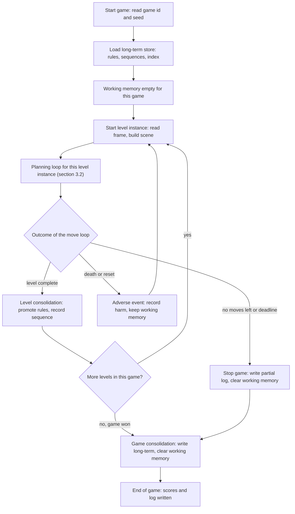

Reading the graph. The loop from "Start level instance" back to itself is the level cycle.
A death does not clear working memory (Kameron, 2026-10-30: "working memory should not clear
on a game lost since that memory will be needed to replay"). Consolidation writes to
long-term memory during the run, which Kameron allowed (2026-10-30).

## 3. Process graphs (depth 1 and 2)

### 3.1 Depth 1: the per-move loop

This runs once for every move. It is the heart of the agent.

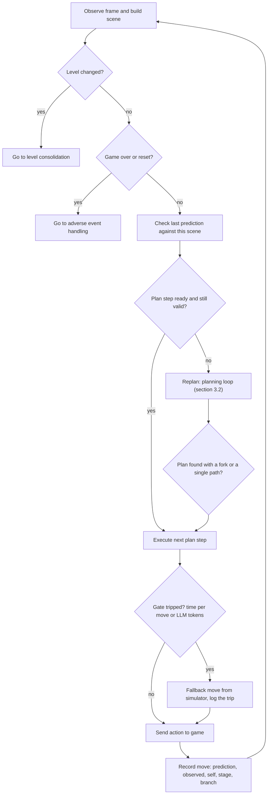

Notes. "Check last prediction" is the miss test: a miss that matters stops the plan
(section 4.10). "Replan" is the planning loop. A gate trip never stops the run. It sends a
fallback move and logs it (section 4.10).

### 3.2 Depth 1: the planning loop

This is Kameron's planning process, used by the agent for its own planning (Kameron,
2026-10-31: "its for the agent's own planning"). It runs on every replan and at each level start.

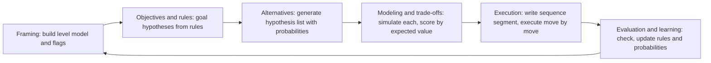

Reading the graph. Evaluation returns to Framing, but a miss that matters returns to
Alternatives first, from the last fork (section 3.6). Framing is repeated only when the
level changes or when the level model needs rebuilding.

### 3.3 Depth 2: how alternatives are generated

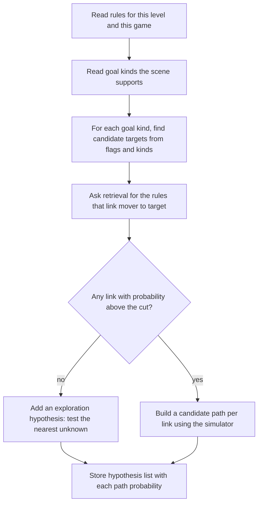

### 3.4 Depth 2: the expected-value choice

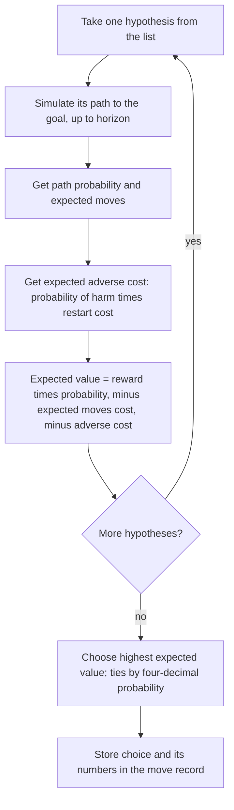

### 3.5 Depth 2: the sequence write and execute cycle

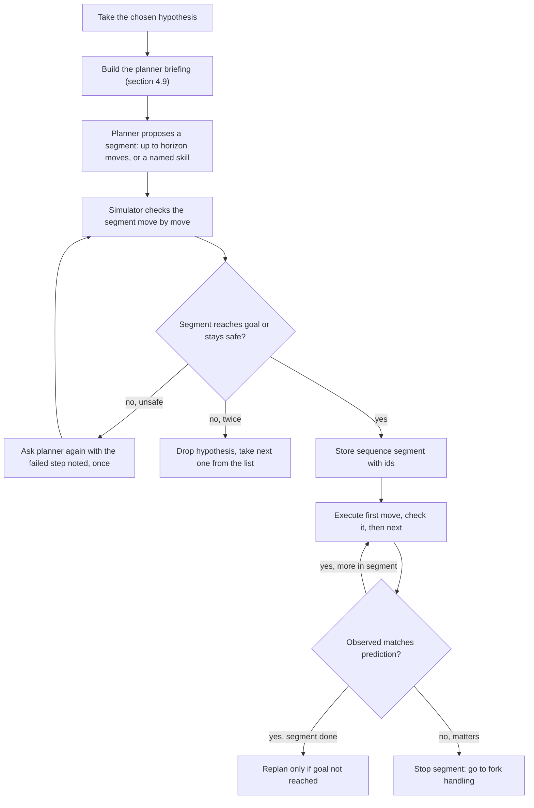

### 3.6 Depth 2: fork handling and replan

Kameron, 2026-10-31: "it should keep the moves that got there" and the agent "would take the
shortest path or least dangerous path, whichever is more favorable for the score."

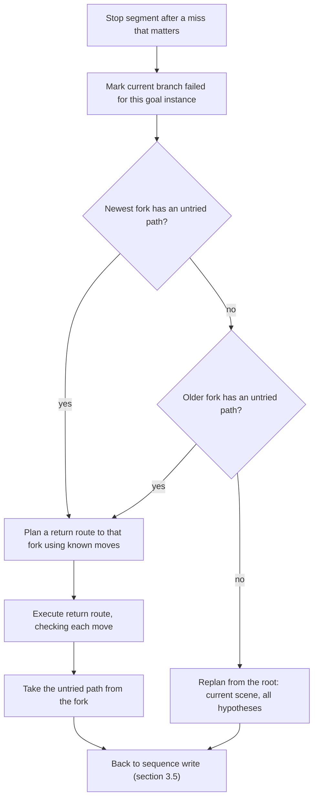

### 3.7 Depth 2: learning from one transition

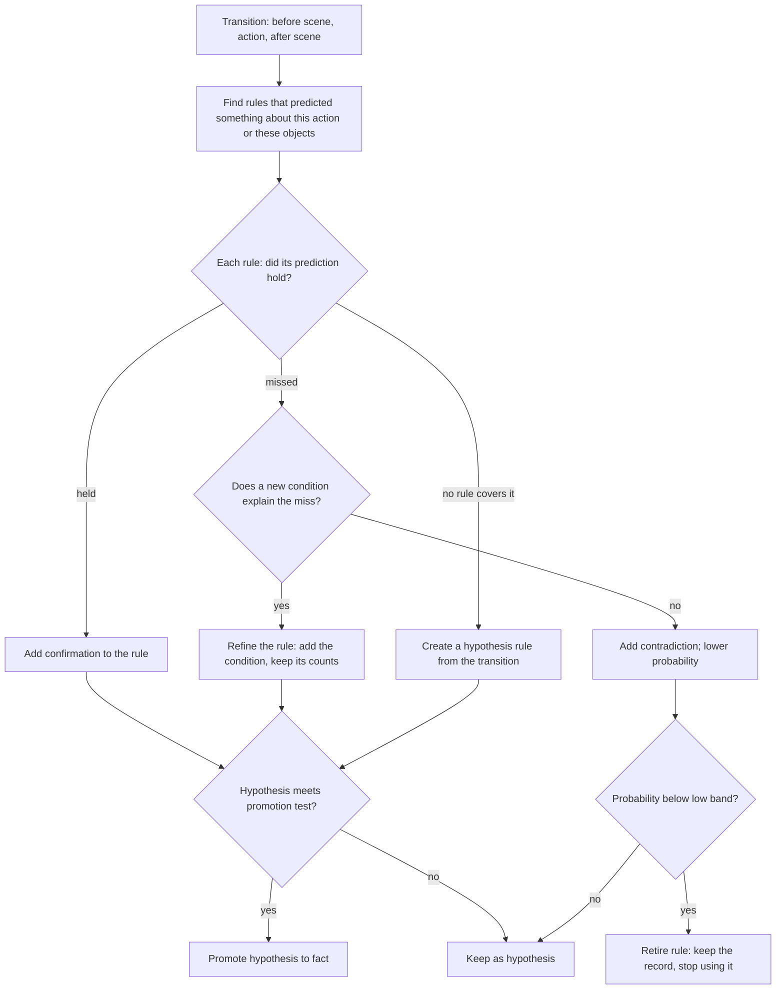

### 3.8 Depth 2: retrieval

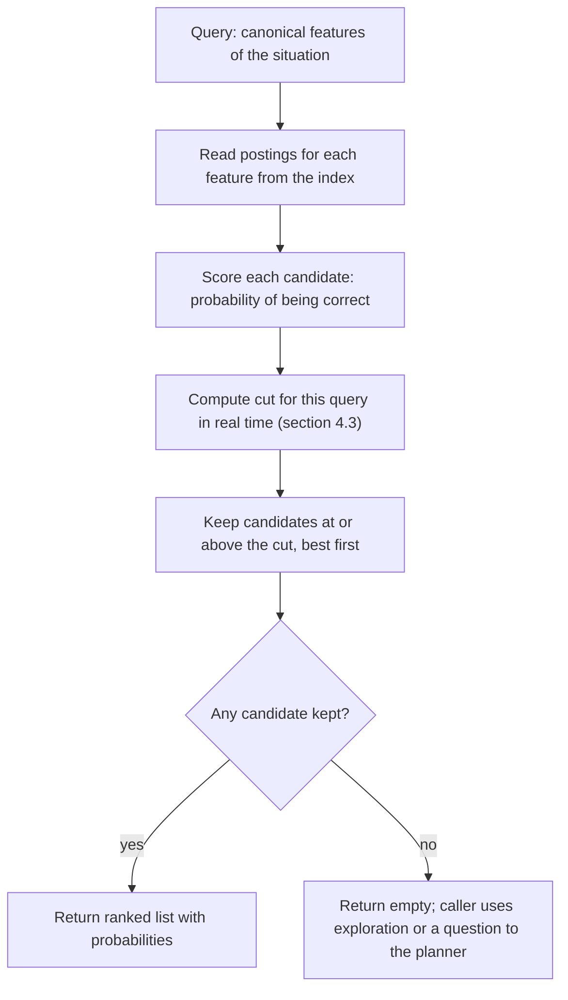

### 3.9 Depth 2: harm, inhibition, and perseverance

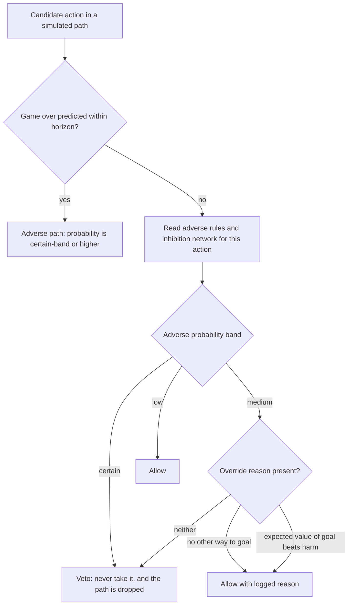

### 3.10 Depth 2: curiosity checks

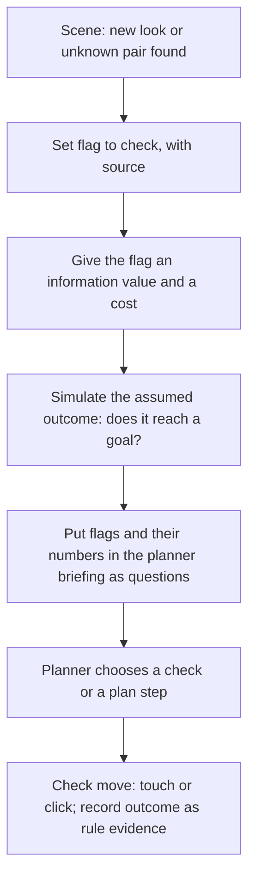

### 3.11 Depth 2: self, focus, and controller

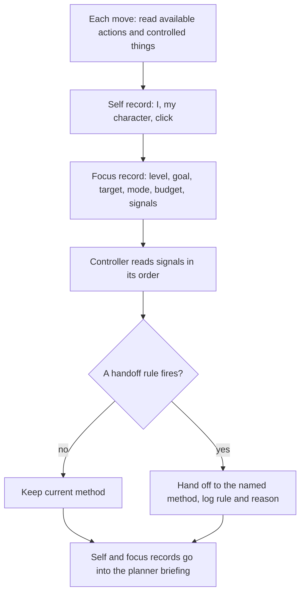

### 3.12 Depth 2: the planner (model-first performance)

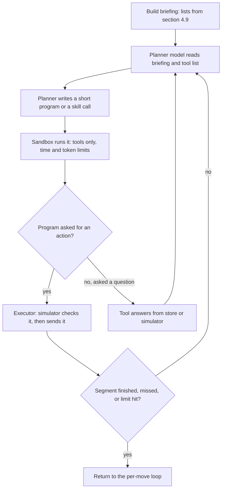

