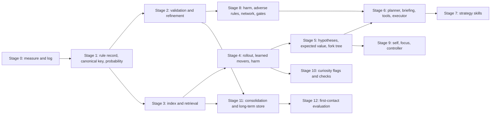

## 5. Reuse map

Every built module, what v2 does with it, and the section that decides it. "Keep" means the
contract stays. "Change" means the contract or use changes. "Off path" means it is not used
by the new agent. "Drop" means Kameron decided it is not part of the agent.

| Module | Status | v2 decision | Section |
|---|---|---|---|
| `core/frames.py`, `core/types.py` | Built | Keep | 4.1 |
| `mind/screen.py` | Built | Keep (review images) | 4.1 |
| `mind/objects.py` | Built | Keep | 4.1 |
| `mind/regions.py` | Built | Keep | 4.1 |
| `mind/kinds.py` | Built | Keep | 4.1 |
| `mind/noise.py` | Built | Keep (Kameron: "useful for the new build") | 4.1 |
| `mind/modes.py` | Built | Change: active controller feeds the self record | 4.1, 4.5 |
| `mind/facts.py` | Built | Change: becomes the rule store (scope, status, probability, canonical key) | 4.2, 4.3, 4.4 |
| `mind/goals.py` | Built | Change: goal guesses kept; ranking by path probability; `learn_win` and `generalize_forms` kept | 4.2, 4.7, 4.12 |
| `mind/predictor.py` | Built | Keep: read-only (Kameron, yes) | 4.8 |
| `mind/game_model.py` | Built, off path | Reuse as the base of the rollout | 4.8 |
| `mind/kinematics.py` | Built | Change: shared breadth-first search and truncation flag | 4.6 |
| `mind/route.py` | Built | Keep: orders visits to collectibles and goals | 4.6 |
| `mind/search.py` | Built | Change: bounded by path probability; heuristic change only if measured | 4.6 |
| `mind/tester.py` | Built | Change: checks and adverse reasons | 4.10, 4.11 |
| `mind/fluid.py` | Built | Change: decision ladder becomes the planning loop | 3.2, 4.7 |
| `mind/fluid_modules.py` | Built | Change: the four paper modules stay as ablation points; Inhibition becomes rules and the network | 4.10 |
| `mind/fluid_sleep.py` | Built | Change: becomes level consolidation | 4.12 |
| `mind/progress.py` | Built | Keep: signals for the controller | 4.5 |
| `mind/indicator.py` | Built | Keep: signals for the controller | 4.5 |
| `mind/budget.py` | Built | Keep: used by the gates | 4.5, 4.10 |
| `mind/baseline.py` | Built | Keep: the baseline explorer the hybrid uses | 4.5 |
| `mind/modules/voi.py` | Built | Change: information value of a check | 4.11 |
| `mind/modules/transfer.py` | Built | Keep: carries working memory across level instances | 4.12 |
| `mind/modules/base.py` | Built | Keep as reference for the module protocols | 4.10 |
| `mind/modules/inhibition.py` | Built, off path | Drop: "This won't be needed in this current agent" (Kameron) | 4.10 |
| `mind/modules/metacognition.py` | Built, off path | Off path; its role is the controller (4.5) | 4.5 |
| `mind/sleep.py` | Built, off path | Drop: "would not keep this because it overcomplicates things" (Kameron) | 4.12 |
| `mind/wisdom.py` | Built, off path | Drop: "This won't be needed in this current agent" (Kameron) | 4.9 |
| `mind/memory.py` | Built, off path | Drop: replaced by the stores in 4.2 | 4.2 |
| `mind/agent.py` | Built, off path | Drop: the program path's agent; replaced by the planning loop | 3.2 |
| `mind/sandbox.py` | Built, off path | Keep: runs planner programs (Kameron: the code path replaces the action part) | 4.9 |
| `mind/contract.py` | Built, off path | Reuse: parses the planner's reply | 4.9 |
| `mind/turn.py` | Built, off path | Reuse: briefing formatting and limits | 4.9 |
| `mind/vchat.py` | Built, off path | Decide: keep only if the planner reads the screen image (section 7, O3) | 4.9 |
| `mind/assign.py` | Built, off path | Reference only | 4.9 |
| `mind/executive.py` | Built, off path | Not reviewed; reference only | 4.9 |
| `mind/llm_drive.py`, `drive.py`, `toolbox.py`, `tool_fix.py` | Built, off path | Reference for the skill library; not reused as code until reviewed | 4.9 |
| `mind/synthesizer.py` | Built, off path | Not reviewed for this spec; reference only | 4.9 |
| `agent/hybrid.py` | Built | Change: switching rule becomes controller handoff H-e; stall rule benched first | 4.5 |
| `agent/explore.py` | Built | Keep as the fallback explorer; its backtracking is the return route rule | 4.6, 4.10 |
| `agent/guided.py` | Built | Reference: breadth-first search copy; the explorer's win-credit logic is reference | 4.6 |
| `agent/submit.py` | Built | Change: one policy entry for the new agent; `fair_share` kept | 4.10, 4.13 |
| `mind/runlog.py` | Built | Keep, extend fields (4.13) | 4.13 |
| `mind/config.py` | Built | Keep ablation approach | 4.13 |

## 6. Decisions from the review comments (2026-10-30 and 2026-10-31)

Kameron's comments are the authority for every row. All 43 comment threads on the earlier
spec are covered here. Threads are not activated for Claude, so no replies were posted
(section 7, O14).

**Memory (Part 1)**

| Question | Answer | Applied in |
|---|---|---|
| Q1 RESET after game over | Working memory is per game. Clear it when the game ends, not on a loss, so the memory can be used to replay. | 4.2 clear rules |
| Q2 Long-term update during a scored run | Allowed. | 4.12c |
| Q3 "Validated" | "Validated just means that the rule is a fact rather than a hypothesis." A rule starts as a hypothesis and is refined as observations arrive (the enemy example). | 4.2 status rules, 4.4b |
| Q4 Held-out game set | There is no held-out set. The 25 public games are observation only (C1). | 1 (C1), 4.12d |

**Retrieval (Part 2)**

| Question | Answer | Applied in |
|---|---|---|
| Q1 "Most probable" | A probability score: the likelihood the information is correct. Not age, not recency. | 4.3, 4.4 |
| Q2 k or threshold | Threshold, set in real time. No fixed k. | 4.3 rule 8 |
| Q3 Learned scorer | A network: it improves as levels and games happen, and later games are harder. | 4.10b (the network is built now), 4.3 |
| Q4 HCQM construct | 1.7. | 4.3 (the construct label for the retrieval module) |

**Metacognition and self (Part 3)**

| Question | Answer | Applied in |
|---|---|---|
| Q1 "Click present" | Action 6 is available. | 4.5a rule 2 |
| Q2 "I" on keyboard moves when a click exists | Yes. "I" is the agent manipulating the actions; the character is an extension of oneself. This changes the earlier source rule that made "I" the click in that case; O4 asks for confirmation. | 4.5a rule 1 |
| Q3 Self labels: prompt, decisions, or both | Both. "It might be talking to itself." Metacognition is supposed to do that. | 4.5a rule 4, 4.5d |
| Q4 Signal order | Set after the workflow is reviewed. | 4.5c rule 1, O2 |
| Q5 Controller per level | No. The controller is for its purpose only. | 4.5c rule 4 |

**Visual-spatial (Part 4)**

| Question | Answer | Applied in |
|---|---|---|
| Q1 Admissible heuristic | Only if it makes the agent take fewer moves and still complete levels. | 4.6c rule 2 |
| Q2 Continuous movement | Kameron cannot see it; only the agent does. The agent checks (continuous movement check). | 4.8c |
| Q3 Q-learning as policy or value estimate | Kameron's words: "a highly specialized math engine ... should help significantly with decision making." The spec takes this as a value estimate, gated after the store and index exist (risk stated in 4.6f). | 4.6f, O6 |
| Q4 `route.py` | "I have no idea what route.py does or if its worth keeping." Answered in 4.6b: it orders visits to collectibles and goals, so it is kept. | 4.6b |

**Planning (Part 5)**

| Question | Answer | Applied in |
|---|---|---|
| Q1 Expected-value rule | Yes: expected value scoring, because it needs fewer steps to find the best plan. | 3.4, 4.7b |
| Q2 Definition of a fork | A plan or path that could go two ways toward the same goal. Take the shortest or the least dangerous, whichever scores better. | 4.7c, 3.6 |
| Q3 Keep or replay moves to a fork | Keep them. The simulator covers them anyway unless unknown objects remain. | 4.7c rule 3 |
| Q4 Explorer backtracking as replan | Yes, the replan step. | 4.7c rule 6, 3.6 |

**Perform (Part 6)**

| Question | Answer | Applied in |
|---|---|---|
| Q1 One list per goal or per level | One list per level, so the agent acts in sequence. Parts of it can be deterministic, for example "enemy blocks path, then kill it" or "pitfall blocks path, then replan route around it." | 4.9d skills, 4.6 |
| Q2 Network now or later | Now: there is no held-out set, and inhibition rules are added as levels and games progress. | 4.10b |
| Q3 What counts as harm | A health bar: anything that reduces it. No health bar: anything that kills the player and sends it back to the path start, or ends the level or game. | 4.10a |
| Q4 Code path beside or replacing action performance | It replaces the action part. The agent moves to a model-first design with skills and tools. | 4.9 |

**Prediction (Part 8)**

| Question | Answer | Applied in |
|---|---|---|
| Q1 Strict read-only rule | Yes. The LLM uses a simulated model to check the next few moves and writes the next sequence before it remodels. This keeps it from oscillating between two tiles. | 4.8a, 4.9e, 3.5 |
| Q2 Independence approximation | No. | 4.4c (chain rule) |
| Q3 Horizon | Each level's typical moves per completion. | 4.7 horizon rule |
| Q4 Enemies that move on their own | Kameron does not know which games have them, and asks the agent to draw from the concept: avoid enemies, collect things like pacman's fruit before completing the level. | 4.8b |
| Q5 Ranking by path probability alone | Yes. Four trailing decimals mean no ties. | 4.4 rule 4, 4.7a rule 4 |

**Curiosity (Part 9)**

| Question | Answer | Applied in |
|---|---|---|
| Q1 Designer labels as well as derived flags | The agent derives flags itself. It may create its own labels. | 4.11a |
| Q2 Social check | No. There are no other players. | 4.11 (dropped) |
| Q3 Checks before the plan | The LLM decides on its own. Propose questions to it, so it decides faster instead of being told what to do. | 4.9c, 4.11b rule 5 |
| Q4 Owner of the planning loop | The agent's own planning. | 3.2 |

**Visual-spatial (Part 4) and grit (Part 7)**

| Question | Answer | Applied in |
|---|---|---|
| Grit Q1 Time gate scope | Per move, so no single move takes all the time. | 4.10d rule 1 |
| Grit Q2 Which tokens | LLM tokens only, to stop overbuilding on one move. | 4.10d rule 2 |
| Grit Q3 Probability bands | 0.8 and 0.3. | 4.4 rule 3 |
| Grit Q4 "No other way" reason | Either reason is enough: no other way, or the expected value beats the harm. Example: fire reduces health, so the agent can walk through it if the simulator shows it reaches the enemy with enough health. | 4.10c |
| Grit Q5 Override trials and the budget | The simulator runs first, so this is not a problem. | 4.10c |

**Schedule (Part 1 review)**

| Question | Answer | Applied in |
|---|---|---|
| Build-order cut | "11-1 is the last and final submission allowed." | 1 (final date), O1 |

**Module comments (section 2.2 of the as-built spec)**

| Module | Comment | Applied in |
|---|---|---|
| `wisdom.py` | "This won't be needed in this current agent." | Dropped (section 5) |
| `sleep.py` | "I would not keep this because it overcomplicates things currently." | Dropped (section 5) |
| `noise.py` | "This seems useful for the new build." | Kept (section 5) |

## 7. Open items

These need Kameron's decision or a measurement. Nothing in this list is decided by the spec.

- **O1. Final submission date.** Kameron's comment says 2026-11-01 is the last and final submission. The earlier project note said 2026-11-02 23:59 UTC. This spec uses 2026-11-01. Confirm against the competition page.
- **O2. Controller signal order.** Section 4.5c lists the handoffs without an order. Kameron set this question for after the workflow review. Order it after reading 3.11.
- **O3. Model and screen input.** The planner is a language model with open weights, offline. Two decisions remain: which model, and whether the planner reads the screen image (`vchat.py`) or the scene alone. The Host question on the eligibility of model-based entries is still open (as-built spec, section 1).
- **O4. Change to the "I" rule.** Section 4.5a rule 1 changes the source rule (the click is "I" when both exist). Kameron's comment says "I" is always the agent. Confirm.
- **O5. Meaning of "no" on independence.** Read here as "not acceptable," which the chain rule (4.4c) follows. Confirm.
- **O6. Q-learning scope.** The spec takes Kameron's remark as a value estimate, gated after the store and index. He did not answer the policy-or-value question in those words. Confirm, and accept the risk in 4.6f that tabular Q-learning will not converge at these move counts.
- **O7. Placeholders.** Set or measure each one. The list:
  - Promotion count: 5 confirmations (4.4b).
  - Certain band 0.8, medium floor 0.3, path floor 0.3 (4.4, 4.6c, 4.7a).
  - Retrieval cut factor: half of the best probability (4.3 rule 8).
  - Horizon cap before the first completion: 200 moves (4.7).
  - Time gate per move, and LLM token gate per move (4.10d).
  - Trials per rule per level for perseverance: 3 (4.10c).
  - Network size and the adverse-rule confirmation count of 5 (4.10b).
  - Briefing list lengths (4.9a).
  - Information value weight for goals (4.11c).
  - Skill margins for S-ATTACK (4.9d).
- **O8. Health without a health bar.** This spec sets implicit health to one harm (4.10a rule 3). Confirm.
- **O9. Collectible value.** Estimated from observed gains (4.8b rule 4). Confirm the source of the value.
- **O10. First-contact evaluation.** A proposal in 4.12d, not a Kameron decision. Accept or change.
- **O11. Build scope for 2026-11-01.** Section 8 lists the full build, which is weeks of work. The submission cut must be chosen with Kameron (section 8.2 gives a candidate).
- **O12. Unverified facts about the games.** Enemy presence, collectibles, continuous movement, and move counters differ by game. The agent must discover them. The spec does not assume any of them.
- **O13. Threads.** All 43 comment threads are not activated for Claude. Claude cannot reply to or resolve them. To get replies, Kameron can send a thread to Claude from the artifact page.

## 8. Build path

### 8.1 Dependency graph

### 8.2 Stages, with acceptance tests

Each acceptance test is a logic fixture (section 4 tests). A stage is done when its tests
pass and its log fields (4.13) are written.

| Stage | Builds | Acceptance |
|---|---|---|
| 0 | Move record and level and game summaries (4.13). Gate values logged. | Every move writes a record with all fields. |
| 1 | Rule record, canonical key, probability, bands (4.2, 4.4). | Probability fixtures (4.4 tests); four-decimal ties cannot occur. |
| 2 | Status rules, refinement, promotion test (4.2, 3.7). | The enemy example (4.2 tests): one rule, two refinements, no deletion. |
| 3 | Index, retrieval, real-time cut (4.3). | Equivalence with a full scan on recorded queries; empty result logged. |
| 4 | Rollout, learned movers, harm definition, continuous check (4.8, 4.10a). | Mover fixture; death stop; assumptions logged. |
| 5 | Hypothesis list, expected value, forks, return route (4.7, 3.4, 3.6). | Two-path fixture chooses by expected value; fork return. |
| 6 | Briefing, tool API, question library, executor, planner call (4.9a to 4.9c, 4.9e, 4.9f). | Segment passes or fails the simulator; second call names the failed step. |
| 7 | Strategy skills (4.9d). | S-ATTACK with and without margin; S-AROUND as fallback. |
| 8 | Adverse rules, inhibition network, perseverance, time and token gates (4.10). | Fire example; certain band never allowed; gate trip logged. |
| 9 | Self record, focus record, controller (4.5). | Four self fixtures; first handoff rule named in log. |
| 10 | Flags, labels, checks (4.11). | New look sets flag; check records outcome. |
| 11 | Level and game consolidation, long-term store (4.12). | Promotion only for rules meeting the test; game end clears working memory. |
| 12 | First-contact evaluation and reports (4.12d, 4.13c). | Store never includes the game being scored; calibration fixture. |

### 8.3 Candidate cut for 2026-11-01 (for decision, not decided)

The full build cannot be finished in the time left. One candidate:

1. Keep the built hybrid, unchanged except that its uncommitted stall rule is benched first.
2. Add Stage 0 (logging) so the run is measured.
3. Add the two gates from Stage 8 that are cheap: the time gate per move and the LLM token gate.
4. Submit the hybrid, which is model-free and has benchmarks on record from 2026-10-28 and 2026-10-29 (experiment log). Those benchmarks are offline runs, and the scored result is not known until the run.
5. Start Stages 1 to 12 after the submission.

This candidate is a suggestion. The choice belongs to Kameron (O11).
